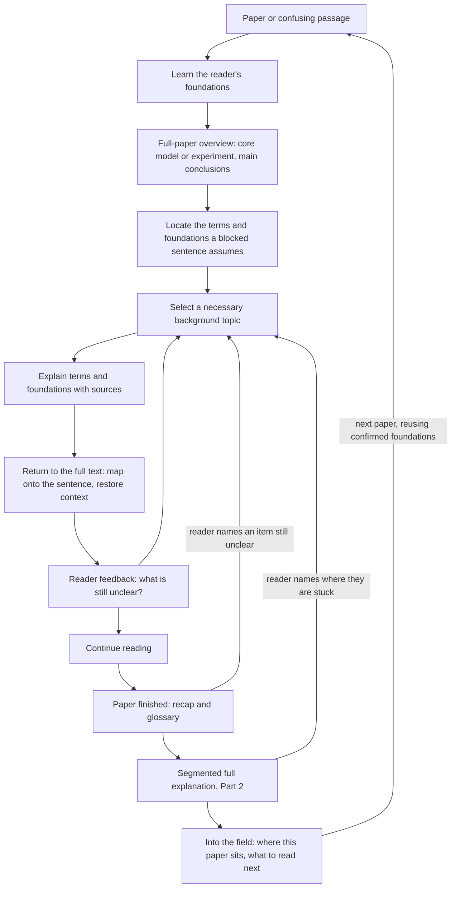

# An Agent for Paper Reading

**English** | [简体中文](README.zh-CN.md)

A physics-grounded agent that helps readers enter unfamiliar research fields by supplying the essential terminology and foundational knowledge needed to understand their papers.

> **Status: first local prototype.** A Claude Code / Codex Skill, Python standard-library helper, and offline tests are available. The host agent provides explanations; the web reader and reader evaluation have not been implemented.

## Why this project

When entering a new field, a reader may be unfamiliar with its basic terms, standard concepts, notation, common models, and underlying assumptions. Research papers often use this background without explaining it, leaving entire paragraphs difficult to follow.

The reader may also be unable to name the missing knowledge or formulate a precise question. Looking up one term can introduce several more unfamiliar concepts, making it hard to find a useful starting point.

The core purpose of this agent is to bridge that entry barrier: identify the essential vocabulary and foundational knowledge assumed by a paper, explain them from the reader's existing background, and help the reader return to passages that were previously inaccessible. The agent adapts to what the reader says along the way; it is a reading aid, not a test of the reader.

Physics provides the initial tasks and correctness checks. The design is intended to extend across physics subfields and into neighboring disciplines, without restricting users by degree, research experience, or specialization.

## Intended reading experience

1. **Start from a paper or a confusing passage.** The reader can simply say, “I am new to this field and cannot follow this paragraph.” A precise technical question is optional.
2. **Learn the reader's foundations.** First lay out the field and the foundational areas it relies on. For topological quantum matter, besides the field itself, these include quantum mechanics, band theory from solid-state physics, symmetry, linear algebra, and basic topological ideas. The reader roughly indicates which areas they have studied, only heard of, or never encountered, or simply says something like “I studied computer science.” This is not a test and can be skipped; the agent fills in the picture from feedback during reading and uses it to distinguish unfamiliar wording from missing foundational knowledge.
3. **Start with a full-paper overview.** Before any sentence-level help, give the reader a basic picture of the whole paper: what question it asks; its core model or experiment (the system studied, the parameters varied, the quantities measured or computed); the authors' main conclusions; the few foundations the whole paper keeps relying on that the reader may not know; and a reading route (which sections and figures carry the main line, which can be skimmed at first). The overview fits on one screen, is pitched to the reader's background, and points to where each item appears in the paper. If the reader arrives with a specific blocked sentence, give a three-to-five-line short overview first, then turn to that sentence. If the reader has already read other papers in the same field, the overview also says which of the foundations this paper needs were covered in earlier papers and which are still missing.
4. **Explain the necessary foundations.** For the blocked sentence, trace back to foundational concepts the reader can grasp, extract only what the sentence relies on, and build a simple, rigorous conceptual picture with reliable sources, unfolding earlier prerequisites when needed. Reuse the picture already built in the overview instead of repeating it. A glossary is only a supporting aid.
5. **Return to the full text.** First go back to the sentence that blocked reading and map the new background onto its words, equations, and figures. Then, with the overview as reference, explain what the passage does in the paper's main line and how it connects to the surrounding text, and point out later places that reuse these concepts. Finally, let the reader continue from where they stopped.
6. **Adjust to feedback.** If the reader is still stuck, find where and unfold further; once the passage makes sense, continue reading.
7. **A recap and a full explanation after reading (Part 2).** Once the reader says they have finished the paper, the agent offers this once and waits for agreement; an explicit request starts it directly. This step ties the piecemeal foundations into a whole and lets readers judge what they have learned; the agent gives no tests or scores and does not claim understanding on their behalf.
   - **First a recap and a glossary.** Before the rigorous pass, one screen recaps what Part 1 covered. It follows the overview's main line rather than the order of the questions: for each item, where in the paper the reader got stuck, which foundation was added, and how it connects back to the text. It then groups foundations as confirmed, explained, or still unsure, and lists the parts of the main line not yet covered, which Part 2 will fill in. The recap draws only on the actual explanation records; if the reader finished without asking anything, it says so. Alongside it comes a glossary for this paper: the terms explained in Part 1 plus the terms and symbols Part 2 will use, each with its meaning in this paper (the simplified Part 1 version), where it first appears, where it was explained, and its current status. Symbols include their notation and conventions, and a word with different meanings in different contexts gets separate entries. If the reader says an item is still unclear, it is marked `unsure`, explained the Part 1 way, and the recap resumes; “just start” skips it. Readers can also ask for the recap or the glossary on its own at any time.
   - **Then the rigorous pass.** This pass no longer simplifies for readability: it states the full model or experimental setup, notation and conventions, approximations and their conditions; follows the key derivation or measurement procedure in logical order; and shows which calculations, measurements, or figures support each main conclusion, how strongly, and with what limits. Part 1 foundations marked `explained` or `known` can be used directly with a pointer to where they were covered; `unsure` is not treated as understood; where a rigorous definition differs from the glossary's simplified version, the difference is stated. The agent first gives an outline, then explains one segment at a time and waits for a response, listing the foundations each segment uses. “Continue” only advances the explanation. Explicit confirmation that a segment makes sense can update its `uses` concepts within the scope of that confirmation, with the reader's words saved as evidence. A named difficulty marks the relevant concept `unsure`; the agent explains it in the Part 1 way and returns to the current segment.
8. **From this paper into the field.** Understanding a paper includes knowing where it sits in its field. This step stays restrained and does three things:
   - **Where this paper sits.** Immediately after Part 2's final segment, or whenever explicitly requested, list the 3 to 5 works the paper directly builds on or contrasts with, grouped as foundational works, direct predecessors, and contrasting works. These come from the paper's own introduction, text, and references. Check each source, label whether its abstract or full text was read, and separate the current authors' description from independently checked facts. Specific conclusions require reading the relevant full text. If fewer works can be verified, list fewer and explain the gap; the overview does not expand this step by default.
   - **Accumulation across papers.** Before an overview, check concepts from other papers: `known` means explicitly confirmed, `explained` means covered but not confirmed, and `unsure` remains a gap. Cite the recorded paper rather than inventing a reading history for concepts without a paper source. Reuse a concept only after checking its meaning and conditions, not just a similar name.
   - **What to read next (optional).** After Part 2 and the paper's position, offer recommendations once and wait for agreement; an explicit request goes directly to recommendations without requiring earlier stages. Give at most 3 verified readings, each with a reason, source link, verification level, and tentatively missing foundations based on the profile. Lecture notes or a review, a foundational paper, and related recent work are useful categories, not a quota.

   No complete body of field knowledge, long literature history, or fully automatic citation network; existing literature search tools can be used when needed.

For example, a paragraph may contain three unfamiliar terms whose definitions depend on a concept the reader has never studied. The agent would identify that shared foundation, explain it using accessible language, clarify each term in context, and guide the reader through the paragraph again.

As another example, a reader meets the sentence “the material hosts topologically protected edge states” and is unsure what “topological” means here or how it relates to quantum physics. Instead of a one-line definition, the agent returns to two starting points the reader can grasp, taking only the parts this sentence uses:

- **Topology** studies properties that survive continuous deformation. A coffee mug can be deformed into a doughnut because both have exactly one hole; the number of holes is an integer and cannot change gradually under such deformation. The analogy only illustrates that an integer stays fixed under continuous change; band topology is not about holes in a physical object.
- **Quantum mechanics** implies that electrons in a crystal can only have energies within certain bands, which may be separated by gaps. In an insulator, the lower bands are filled and separated from the empty upper bands by a gap, so it does not conduct.

Combining the two: for some insulators, the bands carry an integer called a topological invariant, while the vacuum's value is 0. An integer cannot change gradually; it can change only if the gap closes. So at the boundary between the material and the vacuum, there must be gapless, conducting states: these are the edge states. Small perturbations cannot change the integer, which is what “protected” means. The explanation stops there, without a technical derivation, but keeps the conditions under which the conclusion holds: perturbations must not be strong enough to close the gap, and in some materials they must not break certain symmetries.

This explanation itself uses terms such as “band,” “gap,” and “symmetry.” If the reader has indicated no background in solid-state physics, these words first need a sentence or two of explanation, or plainer wording; if the reader has studied it, they can be used directly.

### Planned core outputs

| Output | What it provides |
| --- | --- |
| Full-paper overview | The question the paper asks, its core model or experiment, the main conclusions, the foundations the whole paper relies on, and a reading route; one screen, pitched to the reader's background, with locations in the paper. |
| Field and foundation map | The foundational areas the field relies on, where the reader can mark roughly where they stand. |
| Foundation explanations | Starting from concepts the reader can grasp, only the parts the current sentence relies on, explained simply and rigorously, including how these concepts relate and combine into the paper's terms. |
| Contextual glossary | A supporting reference for basic terms, abbreviations, symbols, aliases or translations, and how they are used in the paper; after Part 1 it becomes a glossary for this paper, with where each term first appears, where it was explained, and its current status, for Part 2 to refer to. |
| Guided return to the full text | Connections from the new background back to the original sentence's words, equations, and figures; the passage's role in the paper and its links to the surrounding text; later places that reuse these concepts; and source links. |
| Recap and full explanation (Part 2) | After the paper is read, a one-screen recap that ties Part 1 together along the main line and separates confirmed, explained, and still-unsure foundations; then a segmented re-explanation of the core theory or experiment at close to the paper's rigor: setup and assumptions, derivation or measurement procedure, chain of evidence, and conditions of validity; each segment lists the foundations it uses, for the reader's self-check. |
| Where this paper sits and what to read next | The few works this paper directly builds on or contrasts with, and how, each checked against its source; reuse of confirmed foundations when reading the next paper in the field; up to 3 optional follow-up readings with reasons and tentatively missing foundations. |

## Design principles

- **Beyond the glossary, down to foundations.** For an unfamiliar term, trace back to foundational concepts the reader can grasp, and explain those concepts and how they combine into the term, rather than only giving a definition.
- **The whole picture first, then the details.** Give a full-paper overview before sentence-level help, so the reader knows the core model or experiment and the main conclusions; every later explanation hangs back onto that picture.
- **Always return to the full text.** Background explanations are a short detour from the paper. Each explanation stays anchored to its place in the text; afterward it returns first to the blocked sentence, then to the paper's line of argument, and the reader continues from where they stopped. However many levels an explanation unfolds, it ends back in the paper.
- **Support readers who cannot yet name their gaps.** Infer candidate needs from the paper and allow “I do not understand this passage” as a starting point.
- **Only what this sentence uses.** From each foundational concept, extract only the aspect the current sentence relies on and build a simple conceptual picture, instead of unfolding a whole course.
- **Simple but rigorous.** Use clear, accessible language instead of technical derivations. Simplify only by omission: details may be left out, but nothing stated may be wrong. Analogies should state their limits, and the key conditions for a conclusion should be kept.
- **Explain with words the reader knows.** Explaining one term inevitably uses others. Every term used should be one the reader already knows, explained on the spot in a sentence or two, or replaced with plainer wording. When unsure, add a short explanation rather than quizzing the reader.
- **Bounded, goal-dependent preparation.** Anchor the background to the selected material. Start with basic comprehension, then deepen support for interpretation, derivation, or critique when needed.
- **Two distinct relationship structures.** A knowledge dependency graph describes what must be understood; an evidence and argument graph describes what supports a paper's claims.
- **Traceable explanations.** Distinguish statements in the paper, background knowledge, and system-generated inferences. Preserve source locations and applicable conditions.
- **Help, not testing.** The agent is a reading aid. It adjusts to what the reader says, such as “still lost” or “I already know this,” instead of quizzing them, and remembers what has been explained to avoid repetition.
- **Simple first, rigorous after, as one loop.** Part 1 simplifies for readability; Part 2, after the paper is read, restores the omitted derivations, conditions, and evidence and uses the foundations from Part 1 directly. Between the two, a recap and a glossary tie the scattered explanations together and let the reader say what still feels shaky before the rigorous derivations begin. How smoothly the reader follows it is the most direct self-check of what they have learned.
- **From one paper into a field, without sprawling.** Understanding a paper includes knowing where it sits in its field. Confirmed foundations carry over between papers, so the more the reader reads, the less there is to fill in; the literature context covers only the few works this paper directly builds on or contrasts with, each checked, never invented.
- **An explicit workflow first.** Start with one controller and modular tools. Introduce additional agents or learned planning policies only when evaluation justifies the complexity.
- **Judge the help itself.** Evaluate whether the needed background is covered, whether explanations are accurate, traceable, and worded in terms the reader knows, and how quickly a reader gets past a blocked passage.

## Proposed architecture



| Module | Responsibility |
| --- | --- |
| Document processing | Parse text, equations, figures, tables, and references while preserving document versions and locations. |
| Field orientation and terminology | Identify assumed basic terms, notation, models, and methods; produce the full-paper overview (core model or experiment, main conclusions, reading route) and a paper-specific glossary. |
| Goal and prerequisite modeling | Outline the foundational areas a field relies on, connect unfamiliar terms to foundational concepts and skills, represent their dependencies, and bound the learning scope. |
| Reader context | Keep roughly where the reader stands on the field's foundation map, what has already been explained, and their feedback, so explanations start from the right place, use words the reader knows, and are not repeated. |
| Retrieval and explanation | Retrieve introductory sources as well as research evidence; explain foundations in accessible language with claim-level provenance. |
| Planning | Choose among asking about background, explaining, unfolding earlier prerequisites, returning to the paper, and stopping. |
| Return to the full text | Map the explained background back to the sentences, equations, and figures that blocked reading, explain the passage's role in the paper and its links to the surrounding text, mark later places that reuse these concepts, and bring the reader back to continue from where they stopped. |

These are the overall module boundaries. Step 1 implements paper caching, source navigation, profiles, and reading records. The host agent performs interpretation and explanation through the Skill; local JSON / JSONL files store state.

## Delivery form

Step 1 uses a Skill and a single-file Python helper. Claude Code / Codex handles interpretation, retrieval, and explanation; the helper handles caching, parsing, navigation, and records without making model API calls. A later web interface can build on these boundaries:

| Step | Form | Purpose |
| --- | --- | --- |
| Step 1 (P0–P1) | An Agent Skill (a `SKILL.md` workflow) with a Python standard-library helper, usable in Claude Code and Codex; background and explanation history are stored in local JSON / JSONL files. | Iterate from actual reading obstacles: where to start, keeping only relevant foundations, staying simple but rigorous, and using words the reader understands. |
| Step 2 (P2–P3) | A local web reading interface built on arXiv HTML: the paper on the left, explanations on the right, the field foundation map at the top, and feedback buttons such as “still lost,” “stuck on this word,” and “I know this.” | Let readers ask about a selected sentence, see explanations mapped to the original sentences and equations, and mark where they stand on the foundation map. |

arXiv HTML is chosen because most physics papers are on arXiv, and the HTML version is converted from the LaTeX source with stable identifiers for paragraphs and equations (such as `S2.p3` and `S2.E1`), so explanations can be anchored precisely without PDF parsing. When a paper has no HTML version, the agent falls back to the LaTeX source or PDF parsing. Once the web interface is stable, it can be packaged as a browser extension for arxiv.org; an MCP server, a Zotero plugin, or other forms can be added later as needed.

## Development roadmap

| Phase | Deliverable | Completion criterion |
| --- | --- | --- |
| P0 — Entry-barrier examples | Passages from two physics subfields, a foundation map for each subfield, and annotations of unfamiliar basic terms, assumed foundations, and introductory sources. | Each example specifies what background a newcomer needs and reliable introductory sources for it. |
| P1 — Terminology and foundations assistant | Delivered as an Agent Skill with the Python standard-library helper: document import, source navigation, foundation explanations, a contextual glossary, guided return to the full text, a recap and full explanation after reading, and where the paper sits in its field, reuse of confirmed foundations across papers, and suggestions for what to read next. | A reviewer can trace explanations to sources and check that the necessary basic concepts are covered. |
| P2 — Personalized gap diagnosis | A field foundation map, prerequisite relationships, the reader's stated background, and a record of what has been explained; a first version of the arXiv HTML reading interface. An interactive map links the paper's main line to the foundation concepts, colors nodes by reader status, and jumps back to the text; readers can edit their own understanding, status, questions, and links, while the agent's explanations and the paper's sources can only be annotated, and the two are stored separately. A field layer connects the papers read so far with the foundations they share. Connect the reader's own literature: read a local folder or Zotero library without modifying it, and match this paper's references to library items by DOI, arXiv ID, and title. Next-reading suggestions check the library first, still list works from outside it with that label, and a set of papers can be put into a reading order. Saving a paper is not reading or understanding it: library items never change concept status, and annotations and notes are read only after the reader turns that on. Unread library items can appear in the field layer. Matching and ordering do not need the interface and can come first as command-line features. | The system can support readers who cannot name their gaps, while avoiding unnecessary repetition of known foundations; the agent never overwrites the reader's edits. Suggestions and reading orders trace back to specific citation relations; the library is read-only, and its item list is never sent to external services. |
| P3 — Feedback-driven reading loop | Step-by-step planning in the reading interface that responds to reader feedback and unfolds prerequisites on demand. Side chat: short questions started from the paper, an explanation, or a map node, answered and then returned to the main thread; repeated side questions about one concept prompt filling in that foundation. | The workflow respects its budget, can terminate, and keeps the reader anchored to the original passage; side questions return to where the main thread left off. |
| P4 — Cross-subfield evaluation | Comparison with a static glossary, ordinary RAG, and a fixed expert reading guide. | Background coverage, explanation accuracy, and time to get past blocked passages are compared under comparable conditions. |
| P5 — Neighboring disciplines | Replaceable domain resources, terminology, evidence criteria, and evaluation criteria. | The adapted workflow is evaluated on held-out tasks in the new domain. |

**Current delivery:** the first local prototype for personal reading trials. The installation and commands below are available; the P2–P3 web interface and subsequent evaluation remain planned. This does not establish a demonstrated comprehension benefit.

## Evaluation plan

The project evaluates the help it gives, not the reader. The first question is whether the workflow helps readers new to a field get past passages that were blocked by unfamiliar terminology and missing foundations. Compare it with a static glossary or introductory reading guide, ordinary retrieval-augmented question answering, and a fixed expert-designed reading guide. Use the same model, source collection, and document parsing where applicable.

Measure:

- Coverage of the necessary foundations annotated in P0, and unnecessary background burden.
- Accuracy of term explanations in their paper-specific context, including equations and figures.
- Explanations that use terms the reader does not know without explaining them.
- Citation support, traceability to sources, and missing assumptions.
- Time from getting stuck to continuing with the paper, including waiting.
- Whether readers judge that they can continue reading, and where they are still stuck.
- Which Part 2 segments readers mark as smooth or stuck; stuck points reveal foundations that Part 1 missed or explained too thinly.
- Whether the Part 1 recap matches the actual explanation records without claiming more was covered; whether the glossary covers the terms and symbols Part 2 uses, and marks where simplified meanings differ from rigorous definitions.
- Whether fewer foundations need filling in when the reader moves to the next paper in the same field, and whether every item in the literature context was checked.
- With the reader's library connected, whether suggested library items are relevant, and whether reading in the suggested order means later papers need fewer foundations filled in.

Reader feedback is used to improve the agent, not to grade readers. Automated checks and expert review can assess most explanation-quality measures; small reader trials are needed to confirm that the help is useful in practice. No such results are claimed yet.

## Reference projects and papers

These are design references, not integrated dependencies or claims of affiliation.

- [Docling](https://github.com/docling-project/docling): structured document parsing.
- [PaperQA](https://github.com/Future-House/paper-qa): scientific retrieval, evidence extraction, and cited answers.
- [RPKT](https://arxiv.org/html/2508.11892v2): recursive prerequisite discovery.
- [GenMentor](https://github.com/GeminiLight/gen-mentor): goal-oriented learner modeling and learning-path organization.
- [Qlarify](https://doi.org/10.1145/3654777.3676397): recursively expandable explanations connected to source passages.
- [ScholarPhi](https://doi.org/10.1145/3411764.3445648): just-in-time, position-sensitive definitions of terms and symbols, drawn from elsewhere in the same paper; this project instead targets background the paper assumes without defining.
- [Paper Plain](https://doi.org/10.1145/3589955): term definitions and plain-language section summaries that help non-expert readers approach medical papers.
- [Pxplore](https://arxiv.org/html/2510.13215v2): goal-driven learner-state modeling and learning-path planning.

Reusing these ideas does not itself establish a novel research contribution. Code, model, and data licenses will need to be checked before adopting specific components.

## Install and use

Requires Python 3.9+. No `pip install` or model API key is needed by the helper. Explanations use your existing Claude Code or Codex environment.

From the repository root:

```sh
sh scripts/install.sh
```

The installer copies the Skill to `~/.claude/skills/paper-foundations/` and `${CODEX_HOME:-$HOME/.codex}/skills/paper-foundations/`, preserving unrelated destination files. Restart the host, then ask:

> Use paper-foundations to help me read this paper. I am new to this field and cannot follow this passage. Explain the necessary foundations, then take me back to the full paper.

Supply an arXiv link or local PDF, optionally with the sentence that blocked you; a technical question is optional. On first reading, the Skill gives a full-paper overview within one screen. If you already supplied a sentence, it first gives a three-to-five-line overview of the question, model or experiment, and main conclusions, then helps with that sentence. Later sessions reuse that overview unless you ask for it again. Before installation, you can also ask the host to read the repository's [SKILL.md](skills/paper-foundations/SKILL.md) directly.

After reading, ask: “Give me a recap and glossary, then a complete, rigorous walkthrough of the theory or experiment.” A complete-walkthrough request first gets a recap of the actual Part 1 explanations and a glossary. The Skill waits for your reply before giving the outline, then explains one segment at a time and waits again. “Skip the recap” goes straight to the outline. “Continue” moves on; “this segment makes sense” explicitly confirms understanding; naming a difficulty leads to a focused explanation and a return to the recap or current segment. Simply saying you finished the paper prompts one invitation covering both the recap and walkthrough. You can also ask for only a recap or glossary, without starting Part 2. An existing recap is reused unless new sentence explanations were added or you explicitly ask to regenerate it.

You can also ask “Where does this paper sit in the field?” or “What should I read next?” at any point. The Skill answers that request directly. By default, it gives the paper's position after the last Part 2 segment, then offers recommendations once and waits for agreement. Later papers reuse the shared profile while keeping confirmed understanding, previous explanations, and uncertainty distinct.

Run the helper separately to inspect acquisition and navigation:

```sh
python3 skills/paper-foundations/scripts/paperread.py fetch 2610.27436v1
python3 skills/paper-foundations/scripts/paperread.py text 2610.27436v1
python3 skills/paper-foundations/scripts/paperread.py text 2610.27436v1 --section S2
python3 skills/paper-foundations/scripts/paperread.py locate 2610.27436v1 "How does a localized, non-Hermitian defect affect"
python3 skills/paper-foundations/scripts/paperread.py context 2610.27436v1 S1.p4
python3 skills/paper-foundations/scripts/paperread.py find 2610.27436v1 "winding number" --after S1.p4
python3 skills/paper-foundations/scripts/paperread.py find 2610.27436v1 '\omega' --after S1.p4
python3 skills/paper-foundations/scripts/paperread.py ref 2610.27436v1 26
python3 skills/paper-foundations/scripts/paperread.py lookup 1002.3895
python3 skills/paper-foundations/scripts/paperread.py lookup 10.1103/RevModPhys.82.3045
python3 skills/paper-foundations/scripts/paperread.py profile concepts --exclude-paper 2610.27436v1
python3 skills/paper-foundations/scripts/paperread.py profile concepts --paper 2610.27436v1 --status unsure
python3 skills/paper-foundations/scripts/paperread.py profile concepts --status known
python3 skills/paper-foundations/scripts/paperread.py glossary-path 2610.27436v1
python3 skills/paper-foundations/scripts/paperread.py log show 2610.27436v1 --type overview --last 1
python3 skills/paper-foundations/scripts/paperread.py log show 2610.27436v1 --type sentence --last 5
python3 skills/paper-foundations/scripts/paperread.py log show 2610.27436v1 --type recap --last 5
python3 skills/paper-foundations/scripts/paperread.py log show 2610.27436v1 --type deep --last 5
python3 skills/paper-foundations/scripts/paperread.py log show 2610.27436v1 --type field --last 5
```

`text` is the only command that outputs plain text. It preserves the reading order of section titles, numbered paragraphs, display equations with LaTeX, and figure/table captions; `--section` includes that section and its subsections. The full structure remains available in `paper.json`. Search both a concept's name and its LaTeX notation, then check the meaning in context. `ref` accepts a reference number or entry ID, such as `26` or `bib.bib19`, and returns the bibliography entry, links, and extracted `doi` / `arxiv_id` (`null` when absent).

`lookup <DOI|arXiv ID>` returns title, authors, year, abstract, source service, and links. It uses the arXiv API for arXiv IDs and OpenAlex with a Crossref fallback for DOI abstracts, caching results under `~/.paperread/lookup/` (or `PAPERREAD_HOME`). Cached lookups work offline; `--refresh` requests a new lookup. Missing abstracts stay `null`, and unavailable services or sources must be reported as verification limits. Finding a title does not verify a claim: read the abstract before marking `checked: "abstract"`, and the relevant full text before making specific scientific claims or marking `fulltext`.

`profile concepts` lists concept records with their status, paper, and location. Filter with `--status known|explained|unsure`, and select a paper with `--paper` or exclude it with `--exclude-paper`; these two paper options are mutually exclusive and both cover all versions of the same arXiv ID. Each concept retains only its current state and latest source, so a paper filter is not its complete learning history. Recaps preserve the paper's actual sentence-log history and check the current state of those concepts, including ones whose latest source is another paper. Records with no paper source may inform background but cannot be presented as concepts covered in a previous paper. Similar names alone do not establish matching concepts or understanding.

`glossary-path <paper>` returns the private `glossary.md` path and whether it exists, just as `outline-path` does for the outline; the helper does not generate or parse the glossary. The host writes and verifies a fixed five-column table: term or symbol, meaning in this paper, first appearance, explanation locations, and status. It covers actual Part 1 explanations and terms planned for Part 2, usually 10–20 entries. It keeps symbol conventions and different meanings separate, uses verified pages for PDFs, and states that statuses are a snapshot governed by the current profile. A saved-file claim requires a successful write. See the [recap and glossary template](skills/paper-foundations/references/output-template.md#第一部分回顾与术语表).

`log show --type overview --last 1` finds an earlier overview even after many sentence explanations: type filtering happens before selecting the last N records. Omit `--type` to include all types; `--last 0` returns all matching records. Old records without `type` count as `sentence`, without rewriting the log. The host records an overview with `type: "overview"` and `where: null`; sentence explanations default to `sentence`. Part 2 uses `type: "deep"`, a positive integer `segment` starting at 1, and a `uses` string array (default `[]`); other types cannot include `segment`. Feedback is appended with the same segment number and the reader's original words, so feedback rows do not count as new segments. Logging an explanation or receiving “continue” never establishes understanding. See the [output templates](skills/paper-foundations/references/output-template.md) for explanation and feedback records.

The paper's position and next readings each use one `type: "field"` record after delivery: `where: null`, `kind: "position"` or `"next"`, and a nonempty `items` array of checked sources; if nothing could be verified, no `field` record is written. Items carry `label`, `title`, `role`, `checked`, and `link`; next readings also require a `missing` string array. Roles are `foundational|predecessor|contrast` for position and `notes|foundational|recent` for next readings. A position label identifies the paper's reference; a next-reading label may be empty or `null`. `checked` is `abstract` or `fulltext` based on what was actually read, not on a successful lookup. Invitations are not completed recommendations, and `field` never accepts `segment` or automatically changes concept status.

After delivering the recap and saving its glossary, the host appends `type: "recap"`, `where: null`, and string arrays `covered` (Part 1 concepts actually recapped) and `terms` (entries in that saved glossary); omitted arrays default to `[]`. Recap-only requests leave `terms` empty; glossary-only requests leave `covered` empty. `log show --type recap` retrieves these records and feedback. Reader replies use separate rows with the original words; invitations and skipped recaps are not logged as recaps. A recap cannot carry `segment` and never changes the profile by itself. Reuse checks compare the last actual generation with later `sentence` rows in log order; recap feedback does not reset that checkpoint. The overview supplies the main line, but briefly mentioning a term there does not count as a focused foundation explanation.

Only the parts actually delivered are reused. A glossary-only record does not establish that a recap was given, and a recap-only record does not establish that a glossary was saved. Before Part 2, the host checks the records, file, and actual output and supplies any missing part, then waits for a reply.

Private data defaults to `~/.paperread/`; override it with `PAPERREAD_HOME`. Both hosts share that profile by default. Cached fetches make no network requests. Older HTML caches are updated by reparsing the saved `source.html` locally, preserving metadata, outlines, and logs; if that source is missing, the tool requests `fetch --refresh`. An unversioned ID uses the highest cached version; add `--refresh` to check for a newer version. Cache names replace `/` in legacy IDs with `_`.

For PDF-only papers, the helper saves the PDF and the host reads it directly using page locations, including the bibliography; `text`, `ref`, and HTML navigation commands are unavailable. The script does not parse PDFs or generate explanations; the host writes `outline.md` after reading the paper. Marking a concept `known` requires `--source` recording explicit reader confirmation; an explanation alone is only `explained`.

```sh
python3 -B -m unittest discover -s tests -v
```

See [implementation.md](docs/implementation.md) for the specification and [validation.md](docs/validation.md) for checks and limitations (Chinese).

The [Part 2 development example](examples/2610.27436v1-deep-trial.md) contains an outline and five segments in Chinese. It checks output structure and evidence boundaries; it contains no real reader feedback between segments.

The [recap and glossary development example](examples/2610.27436v1-recap-trial.md) shows the Part 2 entry with a short recap and 20 contextual terms, plus an isolated simulated profile and a verified offline replay. Only the two actually explained foundations enter the recap; listing terms does not establish understanding.

The [cross-paper development example](examples/2610.27436v1-to-1002.3895-field-trial.md) moves from an SSH impurity paper to a topological-insulator review, showing field context, reading suggestions, carried-over foundations, and tool checks using an isolated simulated profile.

## Repository contents

```text
an-agent-for-paper-reading/
├── README.md / README.zh-CN.md
├── docs/implementation.md          # Step 1 specification
├── docs/validation.md              # Checks and known limitations
├── skills/paper-foundations/
│   ├── SKILL.md                    # Host-agent workflow
│   ├── references/                 # Explanation rules, template, foundation map
│   └── scripts/paperread.py        # Standard-library helper
├── scripts/install.sh              # Copy installation for both hosts
├── tests/                          # Offline tests and hand-authored HTML
└── examples/                       # Explanation smoke tests with stated assumptions
```

Full paper caches and reader profiles stay outside the repository. Examples check the workflow and do not replace actual reader trials.

## License

A project license has not been selected yet.
