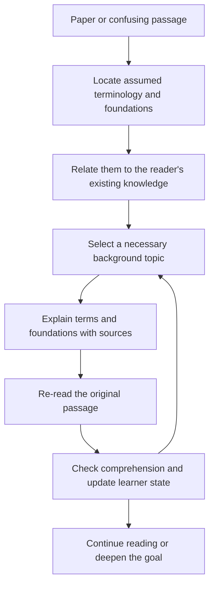

# An Agent on Paper Reading

**English** | [简体中文](README.zh-CN.md)

A physics-grounded agent that helps readers enter unfamiliar research fields by learning the essential terminology and foundational knowledge needed to understand their papers.

> **Status: design stage.** This repository currently contains the project overview and development roadmap. The agent, user interface, and evaluation pipeline have not been implemented.

## Why this project

When entering a new field, a reader may be unfamiliar with its basic terms, standard concepts, notation, common models, and underlying assumptions. Research papers often use this background without explaining it, leaving entire paragraphs difficult to follow.

The reader may also be unable to name the missing knowledge or formulate a precise question. Looking up one term can introduce several more unfamiliar concepts, making it hard to find a useful starting point.

The core purpose of this agent is to bridge that entry barrier: identify the essential vocabulary and foundational knowledge assumed by a paper, explain them from the reader's existing background, and help the reader return to passages that were previously inaccessible. Adaptive planning and understanding checks support this process.

Physics provides the initial tasks and correctness checks. The design is intended to extend across physics subfields and into neighboring disciplines, without restricting users by degree, research experience, or specialization.

## Intended reading experience

1. **Start from a paper or a confusing passage.** The reader can simply say, “I am new to this field and cannot follow this paragraph.” A precise technical question is optional.
2. **Build an initial orientation.** Identify the research problem and the basic terms, symbols, concepts, models, and methods assumed by the selected material.
3. **Connect to what the reader knows.** Use their background and optional brief checks to distinguish unfamiliar wording from missing foundational knowledge.
4. **Explain the necessary foundations.** Provide a contextual glossary and short, linked background lessons with reliable sources, unfolding additional prerequisites when needed.
5. **Return to the original passage.** Show how those terms and concepts explain the sentences, equations, figures, and reasoning that blocked reading.
6. **Check and adapt.** Ask for a short explanation in the reader's own words or an application to a new example, then refine the next step and depth.

For example, a paragraph may contain three unfamiliar terms whose definitions depend on a concept the reader has never studied. The agent would identify that shared foundation, explain it using accessible language, clarify each term in context, and guide the reader through the paragraph again.

### Planned core outputs

| Output | What it provides |
| --- | --- |
| Field orientation | An introduction to the research questions and background relevant to the selected paper. |
| Contextual glossary | Basic terms, abbreviations, symbols, aliases or translations, and how they are used in the paper. |
| Foundation map and short lessons | The concepts and skills needed to understand those terms, their relationships, and a bounded order for learning them. |
| Guided return to the paper | Connections from the newly learned background to the original passages, with source links and brief understanding checks. |

## Design principles

- **Foundations and terminology first.** Help readers understand the field's language and assumed background. Definitions should connect unfamiliar concepts to what the reader already knows.
- **Support readers who cannot yet name their gaps.** Infer candidate needs from the paper and allow “I do not understand this passage” as a starting point.
- **Bounded, goal-dependent preparation.** Anchor the background to the selected material. Start with basic comprehension, then deepen support for interpretation, derivation, or critique when needed.
- **Two distinct relationship structures.** A knowledge dependency graph describes what must be understood; an evidence and argument graph describes what supports a paper's claims.
- **Traceable explanations.** Distinguish statements in the paper, background knowledge, and system-generated inferences. Preserve source locations and applicable conditions.
- **Evidence-based learner state.** Reading an explanation or recognizing a term is not sufficient evidence of mastery. Record independent answers and the amount of assistance used.
- **An explicit workflow first.** Start with one controller and modular tools. Introduce additional agents or learned planning policies only when evaluation justifies the complexity.
- **Measurable outcomes.** Evaluate independent understanding, transfer, and total time rather than treating answer quality or satisfaction as proof of learning.

## Proposed architecture



| Module | Responsibility |
| --- | --- |
| Document processing | Parse text, equations, figures, tables, and references while preserving document versions and locations. |
| Field orientation and terminology | Identify assumed basic terms, notation, models, and methods; build a paper-specific glossary and introductory context. |
| Goal and prerequisite modeling | Connect unfamiliar terms to foundational concepts and skills, represent their dependencies, and bound the learning scope. |
| Learner modeling | Store verified, uncertain, and unmet knowledge states with supporting observations. |
| Retrieval and explanation | Retrieve introductory sources as well as research evidence; explain foundations in accessible language with claim-level provenance. |
| Planning | Choose among diagnosis, explanation, practice, returning to the paper, and stopping. |
| Understanding verification | Check whether readers can explain terms in context and understand previously blocked passages; distinguish independent success from success with hints. |

These are planned module boundaries, not existing software components. The initial implementation can use structured records and a small local database; a dedicated graph database is not required for the first prototype.

## Development roadmap

| Phase | Deliverable | Completion criterion |
| --- | --- | --- |
| P0 — Entry-barrier examples | Passages from two physics subfields, annotated with unfamiliar basic terms, assumed foundations, and introductory sources. | Each example specifies what a newcomer needs to understand and how passage comprehension will be checked. |
| P1 — Terminology and foundations assistant | Document import, source navigation, a contextual glossary, short background lessons, and guided re-reading. | A reviewer can trace explanations to sources and check that the necessary basic concepts are covered. |
| P2 — Personalized gap diagnosis | Prerequisite relationships, optional brief assessments, and a simple learner state. | The system can support readers who cannot name their gaps, while avoiding unnecessary repetition of known foundations. |
| P3 — Adaptive learning loop | Step-by-step planning, focused support, verification, and state updates. | The workflow respects its budget, can terminate, and does not infer mastery merely from exposure. |
| P4 — Cross-subfield evaluation | Comparison with ordinary RAG and a fixed expert learning path. | Independent understanding and total time are measured under comparable conditions. |
| P5 — Neighboring disciplines | Replaceable domain resources, terminology, evidence criteria, and assessment rules. | The adapted workflow is evaluated on held-out tasks in the new domain. |

**Initial MVP scope:** P1–P3, supported by the curated examples from P0. All implementation and evaluation phases are currently pending.

## Evaluation plan

The first evaluation question is whether readers new to a field can understand passages that were previously blocked by unfamiliar terminology and missing foundations. Compare the workflow with a static glossary or introductory reading guide, ordinary retrieval-augmented question answering, and a fixed expert-designed learning path. Use the same model, source collection, and document parsing where applicable.

Measure:

- Correct interpretation of basic terms in their paper-specific context.
- Comprehension of previously blocked passages and transfer to new passages without AI assistance.
- Coverage of necessary foundations, unnecessary background burden, and explanations that introduce further unexplained terms.
- Total time, including diagnosis, reading, practice, and waiting.
- Citation support, equation and figure interpretation errors, and missing assumptions.
- Retention after a delay when the study design permits it.

Keep teaching questions separate from evaluation questions. Simulated learners and automated grading may help with development, but human review and reader studies are needed to establish learning outcomes. No such outcomes are claimed yet.

## Reference projects and papers

These are design references, not integrated dependencies or claims of affiliation.

- [Docling](https://github.com/docling-project/docling): structured document parsing.
- [PaperQA](https://github.com/Future-House/paper-qa): scientific retrieval, evidence extraction, and cited answers.
- [RPKT](https://arxiv.org/html/2508.11892v2): recursive prerequisite discovery; its demonstration motivates adding objective checks rather than relying solely on self-report.
- [GenMentor](https://github.com/GeminiLight/gen-mentor): goal-oriented learner modeling and learning-path organization.
- [Qlarify](https://doi.org/10.1145/3654777.3676397): recursively expandable explanations connected to source passages.
- [Pxplore](https://arxiv.org/html/2510.13215v2): goal-driven learner-state modeling and learning-path planning.

Reusing these ideas does not itself establish a novel research contribution. Code, model, and data licenses will need to be checked before adopting specific components.

## Repository contents

```text
an-agent-on-paper-reading/
├── README.md          # English overview and roadmap
├── README.zh-CN.md    # Chinese overview and roadmap
└── .gitignore         # Local artifacts, credentials, and private data exclusions
```

There is no installation or run command yet. The next step is to curate passages that newcomers cannot follow, annotate their essential terms and foundational dependencies, and establish the source-location and assessment formats before implementation.

## License

A project license has not been selected yet.
