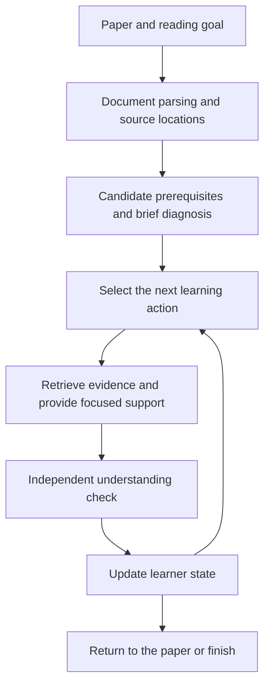

# An Agent on Paper Reading

**English** | [简体中文](README.zh-CN.md)

A physics-grounded agent for reading research papers across fields, designed to identify missing prerequisites and guide readers toward a specific understanding goal.

> **Status: design stage.** This repository currently contains the project overview and development roadmap. The agent, user interface, and evaluation pipeline have not been implemented.

## Why this project

Reading an unfamiliar paper often requires more than definitions of technical terms. The difficult part may be a mathematical tool, a model assumption, an experimental technique, a figure, or an unstated step in an argument.

This project explores how to identify the background a reader actually needs for a particular task, provide explanations grounded in reliable sources, and check whether that support leads to independent understanding.

Physics provides the initial tasks and correctness checks. The design is intended to extend across physics subfields and into neighboring disciplines, without restricting users by degree, research experience, or specialization.

## Intended reading experience

1. **Set a goal.** Understand a result, explain an equation or figure, follow a derivation, or assess a method's applicability.
2. **Identify gaps.** Combine the reader's stated background with short diagnostic questions to locate missing concepts and skills.
3. **Plan prerequisite learning.** Select relevant background, order it, and keep the reading goal and time budget in view.
4. **Explain with evidence.** Retrieve reliable material and connect explanations to source passages, equations, figures, and assumptions.
5. **Check understanding.** Ask the reader to explain, derive, or apply the idea without access to the generated answer.
6. **Adapt and return to the paper.** Update the learner state, revise the next step, or stop when the target task is met.

For example, when a reader encounters an unfamiliar equation, the system would distinguish a notation problem from a missing mathematical skill or an unclear modeling assumption, then offer the relevant support.

## Design principles

- **Goal-dependent prerequisites.** A quick relevance check and a detailed derivation require different levels of preparation.
- **Two distinct relationship structures.** A knowledge dependency graph describes what must be understood; an evidence and argument graph describes what supports a paper's claims.
- **Traceable explanations.** Distinguish statements in the paper, background knowledge, and system-generated inferences. Preserve source locations and applicable conditions.
- **Evidence-based learner state.** Reading an explanation or recognizing a term is not sufficient evidence of mastery. Record independent answers and the amount of assistance used.
- **An explicit workflow first.** Start with one controller and modular tools. Introduce additional agents or learned planning policies only when evaluation justifies the complexity.
- **Measurable outcomes.** Evaluate independent understanding, transfer, and total time rather than treating answer quality or satisfaction as proof of learning.

## Proposed architecture



| Module | Responsibility |
| --- | --- |
| Document processing | Parse text, equations, figures, tables, and references while preserving document versions and locations. |
| Goal and knowledge modeling | Represent target tasks, concepts, skills, prerequisites, and alternative learning paths. |
| Learner modeling | Store verified, uncertain, and unmet knowledge states with supporting observations. |
| Retrieval and explanation | Find relevant sources and generate explanations with claim-level provenance. |
| Planning | Choose among diagnosis, explanation, practice, returning to the paper, and stopping. |
| Understanding verification | Assess independent responses and distinguish success with and without hints. |

These are planned module boundaries, not existing software components. The initial implementation can use structured records and a small local database; a dedicated graph database is not required for the first prototype.

## Development roadmap

| Phase | Deliverable | Completion criterion |
| --- | --- | --- |
| P0 — Task examples | A small set of reading tasks from two physics subfields, with reviewed sources and questions. | Each task has an explicit understanding target and assessment rubric. |
| P1 — Grounded reading assistant | Document import, source navigation, retrieval, and cited explanations. | Key equations and figures are correctly linked; explanations can be checked against their sources. |
| P2 — Gap diagnosis | Candidate prerequisite relationships, brief assessments, and a simple learner state. | Different knowledge states produce justified, bounded recommendations. |
| P3 — Adaptive learning loop | Step-by-step planning, focused support, verification, and state updates. | The workflow respects its budget, can terminate, and does not infer mastery merely from exposure. |
| P4 — Cross-subfield evaluation | Comparison with ordinary RAG and a fixed expert learning path. | Independent understanding and total time are measured under comparable conditions. |
| P5 — Neighboring disciplines | Replaceable domain resources, terminology, evidence criteria, and assessment rules. | The adapted workflow is evaluated on held-out tasks in the new domain. |

**Initial MVP scope:** P1–P3, supported by the curated examples from P0. All implementation and evaluation phases are currently pending.

## Evaluation plan

Use the same model, source collection, and document parsing where possible when comparing the adaptive workflow with ordinary retrieval-augmented question answering and a fixed expert-designed learning path.

Measure:

- Understanding and transfer on unseen questions without AI assistance.
- Total time, including diagnosis, reading, practice, and waiting.
- Citation support, equation and figure interpretation errors, and missing assumptions.
- Retention after a delay when the study design permits it.

Keep teaching questions separate from evaluation questions. Simulated learners and automated grading may help with development, but human review and reader studies are needed to establish learning outcomes. No such outcomes are claimed yet.

## Reference projects and papers

These are design references, not integrated dependencies or claims of affiliation.

- [Docling](https://github.com/docling-project/docling): structured document parsing.
- [PaperQA](https://github.com/Future-House/paper-qa): scientific retrieval, evidence extraction, and cited answers.
- [RPKT](https://arxiv.org/html/2508.11892v2): recursive prerequisite discovery; its demonstration motivates adding objective checks rather than relying solely on self-report.
- [GenMentor](https://github.com/GeminiLight/gen-mentor): goal-oriented learner modeling and learning-path organization.
- [Qlarify](https://doi.org/10.1145/3654777.3676397): recursively expandable explanations connected to source passages.
- [Pxplore](https://arxiv.org/html/2510.13215v2): goal-driven learner-state modeling and learning-path planning.

Reusing these ideas does not itself establish a novel research contribution. Code, model, and data licenses will need to be checked before adopting specific components.

## Repository contents

```text
an-agent-on-paper-reading/
├── README.md          # English overview and roadmap
├── README.zh-CN.md    # Chinese overview and roadmap
└── .gitignore         # Local artifacts, credentials, and private data exclusions
```

There is no installation or run command yet. The next step is to define the P0 task set and establish the source-location and assessment formats before implementing the first reading workflow.

## License

A project license has not been selected yet.
