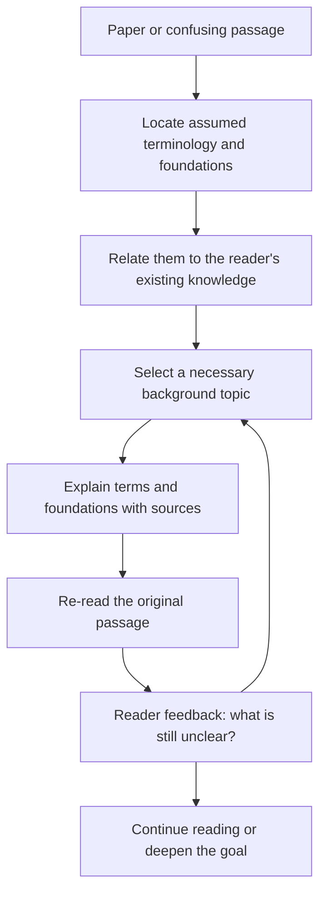

# An Agent for Paper Reading

**English** | [简体中文](README.zh-CN.md)

A physics-grounded agent that helps readers enter unfamiliar research fields by supplying the essential terminology and foundational knowledge needed to understand their papers.

> **Status: design stage.** This repository currently contains the project overview and development roadmap. The agent, user interface, and evaluation pipeline have not been implemented.

## Why this project

When entering a new field, a reader may be unfamiliar with its basic terms, standard concepts, notation, common models, and underlying assumptions. Research papers often use this background without explaining it, leaving entire paragraphs difficult to follow.

The reader may also be unable to name the missing knowledge or formulate a precise question. Looking up one term can introduce several more unfamiliar concepts, making it hard to find a useful starting point.

The core purpose of this agent is to bridge that entry barrier: identify the essential vocabulary and foundational knowledge assumed by a paper, explain them from the reader's existing background, and help the reader return to passages that were previously inaccessible. The agent adapts to what the reader says along the way; it is a reading aid, not a test of the reader.

Physics provides the initial tasks and correctness checks. The design is intended to extend across physics subfields and into neighboring disciplines, without restricting users by degree, research experience, or specialization.

## Intended reading experience

1. **Start from a paper or a confusing passage.** The reader can simply say, “I am new to this field and cannot follow this paragraph.” A precise technical question is optional.
2. **Build an initial orientation.** Identify the research problem and the basic terms, symbols, concepts, models, and methods assumed by the selected material.
3. **Learn the reader's foundations.** First lay out the field and the foundational areas it relies on. For topological quantum matter, besides the field itself, these include quantum mechanics, band theory from solid-state physics, symmetry, linear algebra, and basic topological ideas. The reader roughly indicates which areas they have studied, only heard of, or never encountered, or simply says something like “I studied computer science.” This is not a test and can be skipped; the agent fills in the picture from feedback during reading and uses it to distinguish unfamiliar wording from missing foundational knowledge.
4. **Explain the necessary foundations.** Trace back to foundational concepts the reader can grasp, extract only what the current sentence relies on, and build a simple, rigorous conceptual picture with reliable sources, unfolding earlier prerequisites when needed. A glossary is only a supporting aid.
5. **Return to the original passage.** Show how those terms and concepts explain the sentences, equations, figures, and reasoning that blocked reading.
6. **Adjust to feedback.** If the reader is still stuck, find where and unfold further; once the passage makes sense, continue reading.

For example, a paragraph may contain three unfamiliar terms whose definitions depend on a concept the reader has never studied. The agent would identify that shared foundation, explain it using accessible language, clarify each term in context, and guide the reader through the paragraph again.

As another example, a reader meets the sentence “the material hosts topologically protected edge states” and is unsure what “topological” means here or how it relates to quantum physics. Instead of a one-line definition, the agent returns to two starting points the reader can grasp, taking only the parts this sentence uses:

- **Topology** studies properties that survive continuous deformation. A coffee mug can be deformed into a doughnut because both have exactly one hole; the number of holes is an integer and cannot change gradually under such deformation. The analogy only illustrates that an integer stays fixed under continuous change; band topology is not about holes in a physical object.
- **Quantum mechanics** implies that electrons in a crystal can only have energies within certain bands, which may be separated by gaps. In an insulator, the lower bands are filled and separated from the empty upper bands by a gap, so it does not conduct.

Combining the two: for some insulators, the bands carry an integer called a topological invariant, while the vacuum's value is 0. An integer cannot change gradually; it can change only if the gap closes. So at the boundary between the material and the vacuum, there must be gapless, conducting states: these are the edge states. Small perturbations cannot change the integer, which is what “protected” means. The explanation stops there, without a technical derivation, but keeps the conditions under which the conclusion holds: perturbations must not be strong enough to close the gap, and in some materials they must not break certain symmetries.

This explanation itself uses terms such as “band,” “gap,” and “symmetry.” If the reader has indicated no background in solid-state physics, these words first need a sentence or two of explanation, or plainer wording; if the reader has studied it, they can be used directly.

### Planned core outputs

| Output | What it provides |
| --- | --- |
| Field and foundation map | An introduction to the research questions and background relevant to the selected paper, plus the foundational areas the field relies on, where the reader can mark roughly where they stand. |
| Foundation explanations | Starting from concepts the reader can grasp, only the parts the current sentence relies on, explained simply and rigorously, including how these concepts relate and combine into the paper's terms. |
| Contextual glossary | A supporting reference for basic terms, abbreviations, symbols, aliases or translations, and how they are used in the paper. |
| Guided return to the paper | Connections from the newly explained background to the original sentences, equations, and figures, with source links. |

## Design principles

- **Beyond the glossary, down to foundations.** For an unfamiliar term, trace back to foundational concepts the reader can grasp, and explain those concepts and how they combine into the term, rather than only giving a definition.
- **Support readers who cannot yet name their gaps.** Infer candidate needs from the paper and allow “I do not understand this passage” as a starting point.
- **Only what this sentence uses.** From each foundational concept, extract only the aspect the current sentence relies on and build a simple conceptual picture, instead of unfolding a whole course.
- **Simple but rigorous.** Use clear, accessible language instead of technical derivations. Simplify only by omission: details may be left out, but nothing stated may be wrong. Analogies should state their limits, and the key conditions for a conclusion should be kept.
- **Explain with words the reader knows.** Explaining one term inevitably uses others. Every term used should be one the reader already knows, explained on the spot in a sentence or two, or replaced with plainer wording. When unsure, add a short explanation rather than quizzing the reader.
- **Bounded, goal-dependent preparation.** Anchor the background to the selected material. Start with basic comprehension, then deepen support for interpretation, derivation, or critique when needed.
- **Two distinct relationship structures.** A knowledge dependency graph describes what must be understood; an evidence and argument graph describes what supports a paper's claims.
- **Traceable explanations.** Distinguish statements in the paper, background knowledge, and system-generated inferences. Preserve source locations and applicable conditions.
- **Help, not testing.** The agent is a reading aid. It adjusts to what the reader says, such as “still lost” or “I already know this,” instead of quizzing them, and remembers what has been explained to avoid repetition.
- **An explicit workflow first.** Start with one controller and modular tools. Introduce additional agents or learned planning policies only when evaluation justifies the complexity.
- **Judge the help itself.** Evaluate whether the needed background is covered, whether explanations are accurate, traceable, and worded in terms the reader knows, and how quickly a reader gets past a blocked passage.

## Proposed architecture



| Module | Responsibility |
| --- | --- |
| Document processing | Parse text, equations, figures, tables, and references while preserving document versions and locations. |
| Field orientation and terminology | Identify assumed basic terms, notation, models, and methods; build a paper-specific glossary and introductory context. |
| Goal and prerequisite modeling | Outline the foundational areas a field relies on, connect unfamiliar terms to foundational concepts and skills, represent their dependencies, and bound the learning scope. |
| Reader context | Keep roughly where the reader stands on the field's foundation map, what has already been explained, and their feedback, so explanations start from the right place, use words the reader knows, and are not repeated. |
| Retrieval and explanation | Retrieve introductory sources as well as research evidence; explain foundations in accessible language with claim-level provenance. |
| Planning | Choose among asking about background, explaining, unfolding earlier prerequisites, returning to the paper, and stopping. |
| Guided re-reading | Map the explained background back to the sentences, equations, and figures that blocked reading, and walk the reader through the passage again. |

These are planned module boundaries, not existing software components. The initial implementation can use structured records and a small local database; a dedicated graph database is not required for the first prototype.

## Delivery form

The core logic lives in one Python package: document processing, term and foundation extraction, the field foundation map, explanation generation, and wording checks. Each way of using the agent is a thin layer on top, and model calls go through a common interface so that Claude, GPT, or other models can be used. Delivery is planned in two steps:

| Step | Form | Purpose |
| --- | --- | --- |
| Step 1 (P0–P1) | An Agent Skill (a `SKILL.md` workflow) with the Python core library, usable in Claude Code and Codex; the reader's background and explanation history are stored in local JSON files. | Iterate quickly on explanation quality with the P0 examples: where to start, keeping only the relevant parts, staying simple but rigorous, and using only words the reader knows. |
| Step 2 (P2–P3) | A local web reading interface built on arXiv HTML: the paper on the left, explanations on the right, the field foundation map at the top, and feedback buttons such as “still lost,” “stuck on this word,” and “I know this.” | Let readers ask about a selected sentence, see explanations mapped to the original sentences and equations, and mark where they stand on the foundation map. |

arXiv HTML is chosen because most physics papers are on arXiv, and the HTML version is converted from the LaTeX source with stable identifiers for paragraphs and equations (such as `S2.p3` and `S2.E1`), so explanations can be anchored precisely without PDF parsing. When a paper has no HTML version, the agent falls back to the LaTeX source or PDF parsing. Once the web interface is stable, it can be packaged as a browser extension for arxiv.org; an MCP server, a Zotero plugin, or other forms can be added later as needed.

## Development roadmap

| Phase | Deliverable | Completion criterion |
| --- | --- | --- |
| P0 — Entry-barrier examples | Passages from two physics subfields, a foundation map for each subfield, and annotations of unfamiliar basic terms, assumed foundations, and introductory sources. | Each example specifies what background a newcomer needs and reliable introductory sources for it. |
| P1 — Terminology and foundations assistant | Delivered as an Agent Skill with the Python core library: document import, source navigation, foundation explanations, a contextual glossary, and guided re-reading. | A reviewer can trace explanations to sources and check that the necessary basic concepts are covered. |
| P2 — Personalized gap diagnosis | A field foundation map, prerequisite relationships, the reader's stated background, and a record of what has been explained; a first version of the arXiv HTML reading interface. | The system can support readers who cannot name their gaps, while avoiding unnecessary repetition of known foundations. |
| P3 — Feedback-driven reading loop | Step-by-step planning in the reading interface that responds to reader feedback and unfolds prerequisites on demand. | The workflow respects its budget, can terminate, and keeps the reader anchored to the original passage. |
| P4 — Cross-subfield evaluation | Comparison with a static glossary, ordinary RAG, and a fixed expert reading guide. | Background coverage, explanation accuracy, and time to get past blocked passages are compared under comparable conditions. |
| P5 — Neighboring disciplines | Replaceable domain resources, terminology, evidence criteria, and evaluation criteria. | The adapted workflow is evaluated on held-out tasks in the new domain. |

**Initial MVP scope:** P1–P3, supported by the curated examples from P0. All implementation and evaluation phases are currently pending.

## Evaluation plan

The project evaluates the help it gives, not the reader. The first question is whether the workflow helps readers new to a field get past passages that were blocked by unfamiliar terminology and missing foundations. Compare it with a static glossary or introductory reading guide, ordinary retrieval-augmented question answering, and a fixed expert-designed reading guide. Use the same model, source collection, and document parsing where applicable.

Measure:

- Coverage of the necessary foundations annotated in P0, and unnecessary background burden.
- Accuracy of term explanations in their paper-specific context, including equations and figures.
- Explanations that use terms the reader does not know without explaining them.
- Citation support, traceability to sources, and missing assumptions.
- Time from getting stuck to continuing with the paper, including waiting.
- Whether readers judge that they can continue reading, and where they are still stuck.

Reader feedback is used to improve the agent, not to grade readers. Automated checks and expert review can assess most explanation-quality measures; small reader trials are needed to confirm that the help is useful in practice. No such results are claimed yet.

## Reference projects and papers

These are design references, not integrated dependencies or claims of affiliation.

- [Docling](https://github.com/docling-project/docling): structured document parsing.
- [PaperQA](https://github.com/Future-House/paper-qa): scientific retrieval, evidence extraction, and cited answers.
- [RPKT](https://arxiv.org/html/2508.11892v2): recursive prerequisite discovery.
- [GenMentor](https://github.com/GeminiLight/gen-mentor): goal-oriented learner modeling and learning-path organization.
- [Qlarify](https://doi.org/10.1145/3654777.3676397): recursively expandable explanations connected to source passages.
- [ScholarPhi](https://doi.org/10.1145/3411764.3445648): just-in-time, position-sensitive definitions of terms and symbols, drawn from elsewhere in the same paper; this project instead targets background the paper assumes without defining.
- [Paper Plain](https://doi.org/10.1145/3589955): term definitions and plain-language section summaries that help non-expert readers approach medical papers.
- [Pxplore](https://arxiv.org/html/2510.13215v2): goal-driven learner-state modeling and learning-path planning.

Reusing these ideas does not itself establish a novel research contribution. Code, model, and data licenses will need to be checked before adopting specific components.

## Repository contents

```text
an-agent-on-paper-reading/
├── README.md          # English overview and roadmap
├── README.zh-CN.md    # Chinese overview and roadmap
└── .gitignore         # Local artifacts, credentials, and private data exclusions
```

There is no installation or run command yet. The next step is to curate passages that newcomers cannot follow, annotate their essential terms and foundational dependencies, and establish the source-location format and explanation-quality criteria before implementation.

## License

A project license has not been selected yet.
