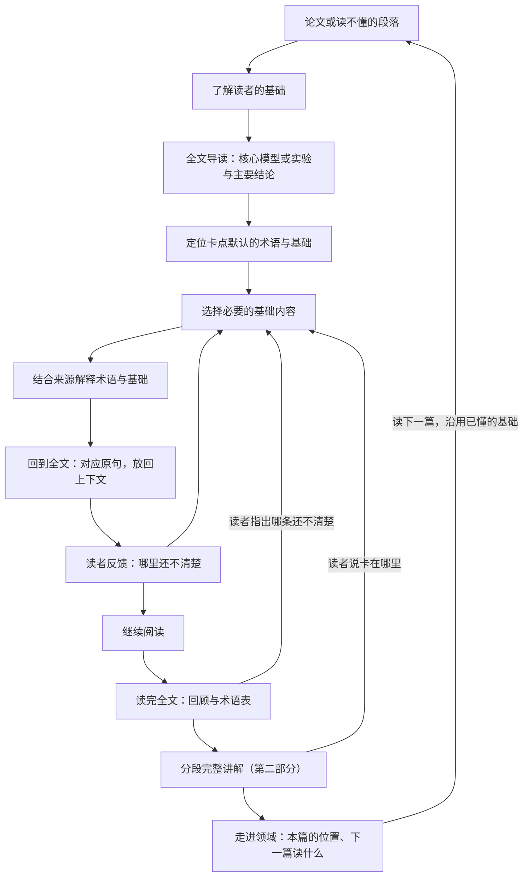

# An Agent for Paper Reading

[English](README.md) | **简体中文**

一个以物理为基础、帮助读者进入陌生研究领域的论文阅读 Agent，通过补充必要的基本术语和基础知识，帮助读者理解原本读不懂的论文。

> **当前状态：第一步本地原型。** 已提供 Claude Code / Codex 可用的 Skill、Python 标准库工具和离线测试。讲解由宿主 Agent 完成；网页阅读界面和读者试用评估尚未实现。

## 为什么做这个项目

刚接触一个领域时，读者往往不了解其中的基本术语、常用概念、符号约定、典型模型和基础假设。研究论文通常默认读者已经具备这些知识，不再逐一解释，因此读者可能连一整段话都无法理解。

此时，读者还可能不知道自己究竟缺少什么，也无法提出准确的问题。查一个术语，又遇到几个新的陌生概念，难以找到合适的学习起点。

这个 Agent 的核心任务是帮助读者跨过这道入门障碍：识别论文默认的必要术语和基础知识，从读者已经理解的内容出发进行解释，再帮助读者回到原文，理解此前读不懂的段落。整个过程根据读者的反馈调整；它是读论文的帮手，不是对读者的测验。

物理提供初始任务和正确性检查。设计面向不同物理子领域，并计划扩展到相邻学科，不以学历、研究经历或专业方向限定使用者。

## 预期阅读流程

1. **从论文或读不懂的段落开始。** 读者可以只说“我刚接触这个领域，这一段看不懂”，无需先提出精确的专业问题。
2. **了解读者的基础。** 先列出这个领域及其依赖的基础领域。以拓扑量子物态为例，除了领域本身，还包括量子力学、固体物理中的能带理论、对称性、线性代数和拓扑的基本概念。读者大致说明哪些学过、哪些只是听说过、哪些没接触过，也可以只说一句“我是学计算机的”。这不是测验，可以跳过；系统会根据阅读中的反馈逐步补全，并据此区分表达不熟悉与真正缺少基础知识。
3. **先给全文导读。** 逐句讲解之前，先让读者对全文有一个最基础的认识：这篇论文在问什么；核心模型或实验是什么（研究对象、调节的参数、测量或计算的量）；作者的主要结论；整篇反复依赖、读者可能不熟的几项基础；以及阅读路线（哪些节和图是主线，哪些可以先略读）。导读控制在一屏以内，按读者的基础来讲，每一项都标出在原文中的位置。读者一开始就带着具体卡住的句子时，先给三五行的简版导读，再讲那一句。读者在同一领域已经读过其他论文时，导读还要说明这篇需要的基础里，哪些在前几篇已经补过，还缺哪些。
4. **补充必要基础。** 对卡住的句子，追溯到读者能理解的基础概念，只提取与当前句子相关的部分，用简明而严谨的语言搭出概念图景，附可靠来源，必要时再往前展开。导读里已经建立的图景直接沿用，不重复讲。术语表只作辅助。
5. **回到全文。** 讲完先回到卡住的那一句，把补充的基础逐一对应到原句中的词、公式和图表；再对照导读说明这一段在全文主线中起什么作用、与前后文如何衔接，并标出后文再次用到这些概念的地方；然后让读者从原处接着往下读。
6. **根据反馈调整。** 读者仍然卡住时，找到卡在哪里，继续展开；这段读通了，就接着往下读。
7. **读完后的回顾与完整讲解（第二部分）。** 读者表示读完全文后，Agent 只提议一次，等同意后再开始；读者明确要求完整讲解时直接开始。这一步既把逐句补上的零散基础串成整体，也让读者自己判断学得怎么样；系统不出题、不打分，不替读者宣称已经理解。
   - **先回顾，并给一份术语表。** 进入严格讲解之前，先用一屏回顾第一部分讲过的内容：按导读的主线组织，每条写清卡在原文哪里、补了什么基础、怎样接回原文；再按“你确认懂了／讲过／仍不确定”分组，并列出主线上还没讲到、第二部分会补的部分。回顾只依据实际的讲解记录，读者没问过问题就直接读完时如实说明。同时给出本篇术语表：第一部分讲过的词，加上第二部分会用到的术语和符号，每条写出它在本文中的意思（第一部分的简化说法）、首次出现和讲过的位置、当前状态；符号附写法和约定，同一个词在不同语境含义不同时分条。读者指出哪条还不清楚，就记为 `unsure`，按第一部分补讲，再回到回顾；说“直接讲”可以跳过。读者也可以随时单独要回顾或术语表。
   - **再严格地讲一遍。** 这一遍不再为读懂而简化：写全模型或实验设定、符号与约定、近似及适用条件，按逻辑顺序走完关键推导或测量流程，说明每个主要结论由哪些计算、测量或图支持，支持到什么程度，局限在哪里。第一部分讲过且状态为 `explained` 或 `known` 的基础可以直接用，标出讲过的位置；`unsure` 不能当作已会；严格定义与术语表里的简化说法不同时明确指出。先给目录，之后一次只讲一段并等待回复，每段末尾列出用到的基础。“继续”只推进讲解；明确表示本段看懂或读顺时，才按确认范围更新本段 `uses` 中的概念，保存原话。卡住时只把相关概念记为 `unsure`，按第一部分补讲，再回到当前段。
8. **从这一篇走进领域。** 读懂一篇论文，也包括知道它在领域中的位置。这一步保持克制，只做三件事：
   - **本篇在领域中的位置。** 默认紧接第二部分最后一段给出，读者主动问时也可直接给。列出本篇直接依赖或对照的 3 到 5 项工作，分为奠基工作、直接前作和对照工作，取自本篇引言、正文和参考文献。逐条核对来源，标明读到摘要还是全文，区分本文作者对前作的描述与来源核对后的事实；具体结论须读原文相关部分。核实不足时少列并说明，不凑数；首次导读不展开这一项。
   - **跨篇积累。** 导读前查看其他论文的概念记录：`known` 表示明确确认懂了，`explained` 只表示讲过，`unsure` 仍需补。标出真实的论文来源，不把缺少来源的概念编成前一篇学过的内容。沿用基础前核对含义和适用条件，不仅按名称相似判断。
   - **下一篇读什么（可选）。** 第二部分和本篇位置都结束后，只提议一次，等同意再推荐；主动要求时直接推荐，不强制先完成其他阶段。最多 3 篇已核实文献，每篇附理由、来源链接、核对层次和按档案暂定还缺的基础。讲义或综述、奠基论文、相关新工作是可选类别，不必凑齐。

   不做完整的领域知识体系、长篇文献史或全自动引用网络；需要时借助现有的文献检索工具。

例如，一段话连续出现三个陌生术语，而这些术语的定义又依赖一个读者从未学过的概念。系统应识别这项共同基础，用读者能够理解的语言讲清，再解释各术语在文中的含义，并引导读者重新理解这一段。

再如，读者读到“这种材料存在受拓扑保护的边缘态”，却不清楚“拓扑”在这里指什么，也不知道它和量子物理有什么关系。系统不会只给一条术语定义，而是回到读者能理解的两个起点，并且只取这句话用到的部分：

- **拓扑**：研究在连续形变下保持不变的性质。咖啡杯可以连续变形成甜甜圈，因为两者都只有一个洞；洞的个数是整数，不会在连续形变中一点点改变。这个类比只用来说明“整数在连续变化中保持不变”，能带的拓扑并不是实物形状上的洞。
- **量子**：按照量子力学，晶体中电子的能量只能落在一段段“能带”里，能带之间可以隔着能隙。绝缘体中较低的能带被电子填满，与上方的空能带隔着能隙，因此不导电。

再把两者合起来：某些绝缘体的能带可以算出一个只能取整数的“拓扑不变量”，而真空的这个数是 0。整数不能连续变化，要改变就必须让能隙闭合，所以在材料和真空的交界处必然存在能隙闭合、可以导电的状态，这就是边缘态。微小的扰动改变不了这个整数，这就是“保护”。讲解到这里为止，不展开专业推导，但保留结论成立的条件：扰动不能大到让能隙闭合，在一些材料中还不能破坏特定的对称性。

这段讲解本身又用到了“能带”“能隙”“对称性”等术语。如果读者表示没学过固体物理，这些词就要先用一两句话讲清，或换成平实的说法；如果读者学过，就可以直接使用。

### 计划提供的核心内容

| 内容 | 作用 |
| --- | --- |
| 全文导读 | 论文在问什么、核心模型或实验、主要结论、整篇依赖的基础和阅读路线；一屏以内，按读者的基础讲，标出原文位置。 |
| 领域与基础地图 | 列出这个领域依赖的基础领域，读者可以在上面标出自己的大致位置。 |
| 基础概念讲解 | 从读者能理解的基础概念讲起，只讲与当前句子相关的部分，用简明而严谨的语言说明这些概念之间的关系，以及它们如何组合成文中的术语。 |
| 上下文术语表 | 作为辅助，解释基本术语、缩写、符号、别名或译名，以及它们在论文中的具体用法；第一部分读完后整理成本篇术语表，标出首次出现、讲过的位置和当前状态，供第二部分直接引用。 |
| 回到全文的引导 | 将补充的基础对应回原句中的词、公式和图表，说明这一段在全文中的作用和前后衔接，标出后文再次用到这些概念的位置，并提供来源链接。 |
| 回顾与完整讲解（第二部分） | 读完全文后，先用一屏回顾第一部分讲过的内容，按主线串起来，分出确认懂了、讲过和仍不确定的基础；再以接近原文的严谨程度分段重讲核心原理或实验：设定与假设、推导或测量流程、证据链、适用条件；每段标出用到的基础，供读者自查。 |
| 本篇在领域中的位置与下一步阅读 | 本篇直接依赖或对照的几项工作及其关系，逐条核对来源；读同领域下一篇时沿用已确认懂了的基础；可选的最多 3 篇后续文献，附理由和各自暂定还缺的基础。 |

## 设计原则

- **不止于术语表，讲到基础概念。** 对陌生术语，追溯到读者能理解的基础概念，讲清这些概念以及它们如何组合成文中的术语，而不是只给定义。
- **先看全貌，再读细节。** 逐句讲解之前先给全文导读，让读者知道核心模型或实验和主要结论；之后每次讲解都挂回这张全貌。
- **讲完一定回到全文。** 补充讲解只是暂时离开论文的一小段路。每次讲解都带着它在原文中的位置，讲完先回到卡住的句子，再放回全文的脉络，读者从原处接着读；展开的层次再多，最后也要收回到原文。
- **支持尚不能描述知识缺口的读者。** 从论文中提出可能缺少的知识，允许以“这段看不懂”作为起点。
- **只讲这句话用到的部分。** 从每个基础概念中只提取当前句子需要的那一面，组成一个简单的概念图景，不展开成整门课。
- **简单但不失严谨。** 用清楚易懂的语言代替专业推导。简化只做减法：可以略去细节，但不能说错；类比要说明适用范围，并保留结论成立的关键条件。
- **讲解只用读者懂的词。** 解释一个术语时难免用到其他术语。每个用到的术语，要么读者已经了解，要么当场用一两句话讲清，要么换成平实的说法；拿不准时，宁可顺手补一句解释，也不去考读者。
- **控制补学范围并逐步深化。** 围绕所选材料先解决基本读懂的问题，再按需要深入解释、推导或证据审查。
- **区分两种关系结构。** 知识依赖图描述“需要先理解什么”；论文证据与论证图描述“结论由什么支持”。
- **解释可追溯。** 区分论文原述、背景知识和系统生成的推断，保留来源位置及适用条件。
- **帮助而非测验。** 这是读论文的帮手，不考读者。根据读者的反馈（如“还是不懂”“这个我会”）调整，不出题判定掌握；记住已经讲过的内容，避免重复。
- **先简后严，形成闭环。** 第一部分为读懂而简化；读完后的第二部分把省略的推导、条件和证据补回来，并直接使用第一部分讲过的基础。两部分之间先回顾一遍、给一份术语表，把零散的讲解串起来，读者也能在严格推导开始前说出哪里还虚。读者读得顺不顺，就是对学习效果最直接的自查。
- **从一篇走进一个领域，但不铺开。** 读懂一篇也包括知道它在领域中的位置。跨篇沿用读者已懂的基础，读得越多要补的越少；文献脉络只取本篇直接依赖和对照的几项，逐条核对，不编造。
- **先实现明确的工作流。** 从一个控制器和模块化工具起步，只有评估显示有必要时才增加代理或学习型规划策略。
- **评价帮助本身的质量。** 看必要基础是否覆盖、解释是否准确可追溯、是否只用读者能懂的词，以及读者多快能读通卡住的段落。

## 拟议架构



| 模块 | 职责 |
| --- | --- |
| 文档处理 | 解析正文、公式、图表和引用，保留文献版本及原文位置。 |
| 领域入门与术语 | 识别默认的基本术语、符号、模型和方法；生成全文导读（核心模型或实验、主要结论、阅读路线）和与当前论文相关的术语表。 |
| 目标与前置知识建模 | 整理领域依赖的基础领域，将陌生术语关联到基础概念和技能，表示依赖关系，并控制补学范围。 |
| 读者背景 | 记录读者在领域基础地图上的大致位置、已经讲过的内容和读者的反馈，使讲解从合适的起点开始、只用读者能懂的词，并且不重复。 |
| 检索与解释 | 同时检索入门资料与研究证据，用易理解的语言讲解基础，并保留具体主张的来源。 |
| 规划 | 在询问背景、解释、展开更前面的知识、返回原文和停止之间选择下一步。 |
| 回到全文 | 把补充的基础对应回卡住的句子、公式和图表，说明这一段在全文中的作用和前后衔接，标出后文再次用到这些概念的位置，带读者回到原处继续读。 |

以上是整体模块边界。第一步已实现论文缓存、原文定位、档案和记录工具，其余理解与讲解工作由宿主 Agent 按 Skill 执行；数据保存在本地 JSON / JSONL 中。

## 落地形式

第一步采用 Skill 加单文件 Python 工具：Claude Code / Codex 负责理解、检索与讲解，工具负责缓存、解析、定位及读写记录，不另行调用模型 API。后续网页界面可在这些模块边界上继续扩展：

| 步骤 | 形式 | 用途 |
| --- | --- | --- |
| 第一步（P0–P1） | Agent Skill（`SKILL.md` 工作流）加 Python 标准库工具，可在 Claude Code 和 Codex 中使用；读者背景和讲解记录保存在本地 JSON / JSONL 文件中。 | 从真实阅读卡点迭代讲解质量：从哪个基础概念讲起、只取相关部分、简单而严谨、只用读者懂的词。 |
| 第二步（P2–P3） | 基于 arXiv HTML 的本地网页阅读界面：左侧原文，右侧讲解，顶部显示领域基础地图，并提供“还是不懂”“卡在这个词”“这个我会”等反馈按钮。 | 支持选中一句话求助、把讲解对应到原文的句子和公式，以及在基础地图上标出自己的位置。 |

选择 arXiv HTML，是因为物理论文大多发布在 arXiv 上，其 HTML 版由 LaTeX 源码转换而来，段落和公式带有固定编号（如 `S2.p3`、`S2.E1`），讲解可以准确挂到原文位置上，无需解析 PDF。论文没有 HTML 版时，退回 LaTeX 源码或 PDF 解析。网页界面稳定后，可再包装成在 arxiv.org 页面上直接使用的浏览器扩展；MCP server、Zotero 插件等形式以后按需增加。

## 开发路线

| 阶段 | 交付内容 | 完成标准 |
| --- | --- | --- |
| P0 — 入门障碍样例 | 从两个物理子领域选择段落，为每个子领域整理基础领域地图，并标注陌生基本术语、默认基础和入门来源。 | 明确新读者需要补充哪些基础，以及可靠的入门来源。 |
| P1 — 术语与基础补全助手 | 以 Agent Skill 和 Python 标准库工具提供：文档导入、来源导航、基础概念讲解、上下文术语表、回到全文的引导、读完后的回顾与完整讲解，以及本篇在领域中的位置、跨篇沿用已懂的基础和下一步阅读建议。 | 审核者可追溯讲解来源，并检查必要基础概念是否覆盖。 |
| P2 — 个性化缺口诊断 | 领域基础地图、前置关系、读者自述的背景和讲解记录；搭建基于 arXiv HTML 的阅读界面初版。可交互地图：论文主线层与基础概念层相连，节点按读者状态着色，可跳回原文；读者可编辑自己的理解、状态、疑问和连线，Agent 的讲解与原文来源只能批注，两者分开保存。地图另加领域层，把读过的多篇论文和它们共同依赖的基础连起来。接入读者自己的文献：只读读取本地文件夹或 Zotero 库，按 DOI、arXiv 编号和标题把本篇引用与库中条目对上；推荐下一篇时先看库里已有的，库外的照样列出并标明；也可为一组文献排出阅读顺序。收藏不等于读过或读懂，库中条目不改变概念状态；批注和笔记只在读者开启后读取。库里已有、尚未读的文献可显示在领域层。匹配和排序不依赖界面，可以先作为命令行功能实现。 | 能帮助尚不能说清缺口的读者，同时避免重复讲解已掌握的基础；读者的编辑不会被 Agent 覆盖。推荐和阅读顺序能追溯到具体的引用关系；文献库只读，条目清单不发往外部服务。 |
| P3 — 按反馈展开的阅读闭环 | 在阅读界面中根据读者反馈逐步规划，按需展开前置知识。侧栏旁问：从原文、讲解或地图节点发起简短提问，答完回到主线；同一概念被反复旁问时，提示补讲这块基础。 | 流程遵守预算、能够终止，始终围绕原文段落，不把读者带离太远；旁问答完回到主线原来的位置。 |
| P4 — 跨子领域评测 | 与静态术语表、普通 RAG 和固定专家阅读指南比较。 | 在可比条件下比较基础覆盖、解释准确性，以及读通卡住段落所需的时间。 |
| P5 — 相邻学科扩展 | 可替换的领域资源、术语、证据标准和评价规则。 | 在新领域留出的任务上重新验证适配后的流程。 |

**当前交付：** 先完成上述第一步本地原型，供个人阅读试用。下方的安装与命令已经可用；P2–P3 的网页界面及后续评测仍是计划，不能据此声称理解效果已经得到验证。

## 评测计划

评测的对象是帮助本身，不是读者。首先验证：对刚进入某个领域的读者，这套流程能否帮助他们读通此前因术语陌生和基础缺失而卡住的段落。对照包括静态术语表或入门阅读指南、普通检索增强问答，以及固定的专家阅读指南；在适用时使用相同模型、资料库和文档解析结果。

重点测量：

- 是否覆盖 P0 标注的必要基础，以及额外补充的负担。
- 术语在当前论文中的含义是否解释准确，包括公式和图表。
- 解释是否用到了读者不了解、又没有加以说明的术语。
- 引用支持度、来源可追溯性，以及遗漏的假设。
- 从卡住到继续往下读所用的时间，包括等待时间。
- 读者自己判断能否继续读下去，以及仍然卡在哪里。
- 第二部分完整讲解中，读者自己标出的读顺和卡住的段落；卡住的地方用来发现第一部分漏掉或讲得不够的基础。
- 第一部分回顾是否与实际讲解记录一致、没有多写讲过的内容；术语表是否覆盖第二部分用到的术语和符号，简化说法与严格定义不一致的地方是否标出。
- 读同一领域的下一篇论文时，需要补讲的基础是否减少；文献脉络中的每一项是否都经过核对。
- 接入读者文献库后，推荐的库内文献是否相关；按排出的顺序读时，后面的论文需要补讲的基础是否更少。

读者反馈用于改进 Agent，而不是给读者打分。大部分讲解质量指标可以通过自动检查和专家审核来评估；帮助在实际阅读中是否有用，需要小规模读者试用来确认。目前尚未取得这类结果。

## 参考项目与论文

以下是设计参考，不代表已经集成的依赖，也不代表与相关项目存在合作关系。

- [Docling](https://github.com/docling-project/docling)：结构化文档解析。
- [PaperQA](https://github.com/Future-House/paper-qa)：科学文献检索、证据提取与带引用的回答。
- [RPKT](https://arxiv.org/html/2508.11892v2)：递归发现前置知识。
- [GenMentor](https://github.com/GeminiLight/gen-mentor)：目标导向的学习者建模与学习路径组织。
- [Qlarify](https://doi.org/10.1145/3654777.3676397)：可递归展开并关联原文段落的解释。
- [ScholarPhi](https://doi.org/10.1145/3411764.3445648)：在阅读位置即时显示术语和符号的定义，定义取自同一篇论文的其他位置；本项目关注的则是论文默认读者已知、未加定义的基础知识。
- [Paper Plain](https://doi.org/10.1145/3589955)：为非专业读者提供医学论文的术语释义和分节通俗摘要。
- [Pxplore](https://arxiv.org/html/2510.13215v2)：目标驱动的学习者状态建模与路径规划。

复用这些思路本身不构成新的研究贡献。采用具体组件前，需要分别核对代码、模型和数据的许可。

## 安装与使用

需要 Python 3.9+，无需 `pip install`，工具不需要模型 API key。讲解使用你已有的 Claude Code 或 Codex 环境。

在仓库根目录运行：

```sh
sh scripts/install.sh
```

安装器将 Skill 复制到 `~/.claude/skills/paper-foundations/` 和 `${CODEX_HOME:-$HOME/.codex}/skills/paper-foundations/`，保留目标目录中的其他文件。重启宿主后，可以说：

> 使用 paper-foundations 帮我读这篇论文。我刚接触这个领域，这一段看不懂。请补必要基础，再带我回到全文。

附上 arXiv 链接或本地 PDF，可以同时给出卡住的句子；不必先提出专业问题。首次阅读时，Skill 先给一屏以内的全文导读；已经带着具体句子时，先用三到五行介绍研究问题、核心模型或实验及主要结论，再讲解该句。后续直接沿用导读中的图景，按你的要求再给导读。也可以在安装前直接让宿主读取仓库中的 [SKILL.md](skills/paper-foundations/SKILL.md)。

读完后可以说：“请把这篇论文的原理或实验完整、严格地再讲一遍。”Skill 先给目录，再一次讲一段并等你回复。“继续”表示往下讲；“这段看懂了／读顺了”才是明确确认理解；指出卡点后会针对补讲，再回到当前段。仅说读完了，只会得到一次可选择的邀请，不会自动开始完整讲解。

也可以随时问“这篇在领域里是什么位置”或“接下来读什么”，Skill 会直接处理对应请求。默认在第二部分最后一段后给出本篇位置，再提议一次后续阅读并等待同意。读下一篇时沿用共用档案，同时区分已经确认懂了、讲过未确认和仍不确定的基础。

工具可单独运行，用于检查获取和定位：

```sh
python3 skills/paper-foundations/scripts/paperread.py fetch 2610.27436v1
python3 skills/paper-foundations/scripts/paperread.py text 2610.27436v1
python3 skills/paper-foundations/scripts/paperread.py text 2610.27436v1 --section S2
python3 skills/paper-foundations/scripts/paperread.py locate 2610.27436v1 "How does a localized, non-Hermitian defect affect"
python3 skills/paper-foundations/scripts/paperread.py context 2610.27436v1 S1.p4
python3 skills/paper-foundations/scripts/paperread.py find 2610.27436v1 "winding number" --after S1.p4
python3 skills/paper-foundations/scripts/paperread.py find 2610.27436v1 '\omega' --after S1.p4
python3 skills/paper-foundations/scripts/paperread.py ref 2610.27436v1 26
python3 skills/paper-foundations/scripts/paperread.py lookup 1002.3895
python3 skills/paper-foundations/scripts/paperread.py lookup 10.1103/RevModPhys.82.3045
python3 skills/paper-foundations/scripts/paperread.py profile concepts --exclude-paper 2610.27436v1
python3 skills/paper-foundations/scripts/paperread.py profile concepts --status known
python3 skills/paper-foundations/scripts/paperread.py log show 2610.27436v1 --type overview --last 1
python3 skills/paper-foundations/scripts/paperread.py log show 2610.27436v1 --type sentence --last 5
python3 skills/paper-foundations/scripts/paperread.py log show 2610.27436v1 --type deep --last 5
python3 skills/paper-foundations/scripts/paperread.py log show 2610.27436v1 --type field --last 5
```

只有 `text` 输出纯文本，按原文顺序保留节标题、带编号的段落、含 LaTeX 的行间公式以及图表标题；`--section` 包含该节及其子节，完整结构仍可查看 `paper.json`。查找后文时，概念名及其 LaTeX 符号都要搜，再核对上下文中的含义。`ref` 接受参考文献编号或条目 ID（如 `26` 或 `bib.bib19`），返回本篇条目、链接和解析出的 `doi` / `arxiv_id`（没有时为 `null`）。

`lookup <DOI|arXiv 编号>` 返回标题、作者、年份、摘要、来源服务和链接。arXiv 编号查 arXiv API；DOI 先查 OpenAlex，摘要缺失时再查 Crossref。结果缓存在 `~/.paperread/lookup/`（或 `PAPERREAD_HOME` 下），命中缓存时可离线复用，`--refresh` 才重新请求。没有摘要时保留 `null`；服务或来源不可用时须说明核实限制。查到标题不等于确认主张：实际读过摘要才可标 `checked: "abstract"`，具体科学结论及 `fulltext` 标记须以原文相关内容的实际核对为依据。

`profile concepts` 列出概念状态及论文、位置，可用 `--status known|explained|unsure` 筛选，以 `--exclude-paper` 排除当前论文，包括同一 arXiv 编号的其他版本。缺少论文来源的记录可用于判断背景，但不能声称是在前一篇讲过的；术语名字相似也不足以证明概念相同或读者已经理解。

`log show --type overview --last 1` 先筛选类型再取最后一条，避免导读被较新的逐句讲解挤出近期记录而漏判。不传 `--type` 时包含所有类型；`--last 0` 返回全部匹配记录。旧记录缺少 `type` 时按 `sentence` 处理，不改写旧日志。宿主将导读保存为 `type: "overview"`、`where: null`；逐句讲解默认为 `sentence`。第二部分使用 `type: "deep"`，须有从 1 开始的正整数 `segment`，以及字符串数组 `uses`（默认 `[]`）；其他类型不得带 `segment`。反馈另行追加，沿用原段号并保留原话，因此反馈行不能算作新讲解段。讲过以及“继续”都不等于确认读者已经理解。讲解与反馈记录示例见 [输出模板](skills/paper-foundations/references/output-template.md)。

本篇位置和后续推荐实际输出后，各记一条 `type: "field"`：`where: null`、`kind: "position"` 或 `"next"`，以及只含已核实条目、至少一项的 `items` 数组；一项都没核实时不写 `field` 记录。每项有 `label`、`title`、`role`、`checked` 和 `link`，推荐项还须有字符串数组 `missing`。位置角色为 `foundational|predecessor|contrast`，推荐角色为 `notes|foundational|recent`；位置的 `label` 是本篇参考文献标识，推荐的可为空字符串或 `null`。`checked` 按实际阅读填写 `abstract` 或 `fulltext`，不是工具成功就自动确认。邀请不能记为已完成推荐；`field` 不得带 `segment`，也不自动改变概念状态。

数据默认保存在 `~/.paperread/`，可通过 `PAPERREAD_HOME` 指定其他私有目录。两个宿主默认共用这份档案。已缓存论文不会重复下载；旧 HTML 缓存会从本地 `source.html` 重新解析，保留元数据、全文脉络和记录，源文件缺失时才提示 `fetch --refresh`。不带版本号时优先使用本地最高版本，需要查新版本时加 `--refresh`。旧式编号的缓存目录会将 `/` 替换为 `_`。

只有 PDF 时，工具保存 PDF，正文和参考文献都由宿主直接阅读并使用页码定位，不使用 `text`、`ref` 或 HTML 定位命令。脚本不解析 PDF，也不自行生成解释；`outline.md` 由宿主通读论文后写入。`known` 状态必须附 `--source`，记录读者明确确认的依据；讲过只记为 `explained`。

```sh
python3 -B -m unittest discover -s tests -v
```

实现约定见 [implementation.md](docs/implementation.md)，验收结果和边界见 [validation.md](docs/validation.md)。

[第二部分开发样例](examples/2610.27436v1-deep-trial.md)展示目录和五段讲解；它用于检查输出结构与证据边界，没有真实读者逐段反馈。

[跨篇开发样例](examples/2610.27436v1-to-1002.3895-field-trial.md)展示从 SSH 杂质论文进入拓扑绝缘体综述：领域定位、下一篇建议、跨篇基础提示，以及隔离档案中的工具验收。

## 仓库内容

```text
an-agent-for-paper-reading/
├── README.md / README.zh-CN.md
├── docs/implementation.md          # 第一步实现方案
├── docs/validation.md              # 验收记录与已知边界
├── skills/paper-foundations/
│   ├── SKILL.md                    # 宿主 Agent 的工作流
│   ├── references/                 # 讲解规则、模板、领域基础地图
│   └── scripts/paperread.py        # 标准库工具
├── scripts/install.sh              # 复制安装到两个宿主
├── tests/                          # 离线测试与手写 HTML 样例
└── examples/                       # 标明背景假设的讲解试跑
```

论文全文缓存和读者档案不进入仓库。示例用于检查工作流，不能代替真实读者试用。

## 许可证

项目许可证尚未确定。
