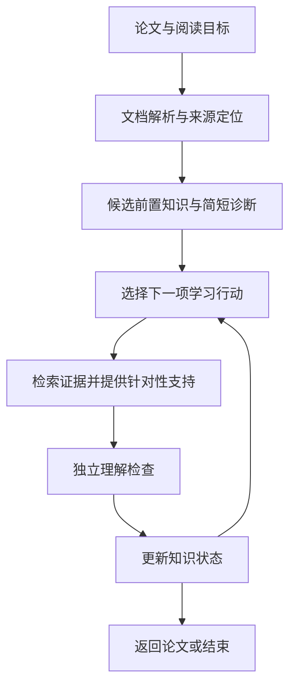

# An Agent on Paper Reading

[English](README.md) | **简体中文**

一个以物理为基础、面向跨领域科研论文阅读的 Agent，旨在识别读者缺少的前置知识，并围绕具体理解目标提供学习支持。

> **当前状态：设计阶段。** 本仓库目前包含项目介绍和开发路线图，尚未实现 Agent、用户界面或评测流程。

## 为什么做这个项目

阅读陌生领域的论文时，困难可能来自数学工具、模型假设、实验技术、图表，或论证中省略的步骤，仅了解术语定义往往还不够。

本项目探索如何判断读者完成当前阅读任务真正需要哪些背景知识，依据可靠来源提供解释，并检查这些帮助是否转化为独立理解。

物理提供初始任务和正确性检查。设计面向不同物理子领域，并计划扩展到相邻学科，不以学历、研究经历或专业方向限定使用者。

## 预期阅读流程

1. **明确目标。** 理解结论、解释公式或图表、跟随推导，或判断方法的适用范围。
2. **识别缺口。** 结合读者自述和简短诊断问题，定位缺少的概念与技能。
3. **安排补学。** 选择相关背景并确定顺序，同时考虑阅读目标和时间预算。
4. **提供有依据的解释。** 检索可靠材料，将解释关联到原文段落、公式、图表和适用条件。
5. **检查理解。** 在不查看生成答案的情况下，让读者独立解释、推导或应用所学内容。
6. **调整并返回论文。** 更新知识状态，修改下一步安排，或在完成目标任务后停止。

例如，遇到陌生公式时，系统应区分符号不熟悉、缺少数学技能和模型假设不清楚这几种情况，再提供对应支持。

## 设计原则

- **前置知识取决于目标。** 快速判断论文相关性和完整理解推导，需要不同程度的准备。
- **区分两种关系结构。** 知识依赖图描述“需要先理解什么”；论文证据与论证图描述“结论由什么支持”。
- **解释可追溯。** 区分论文原述、背景知识和系统生成的推断，保留来源位置及适用条件。
- **用证据更新知识状态。** 看过解释或认得术语不足以证明掌握；记录独立作答和所需提示程度。
- **先实现明确的工作流。** 从一个控制器和模块化工具起步，只有评估显示有必要时才增加代理或学习型规划策略。
- **用实际结果评价。** 测量独立理解、知识迁移和总耗时，不把回答质量或满意度直接当成学习效果。

## 拟议架构



| 模块 | 职责 |
| --- | --- |
| 文档处理 | 解析正文、公式、图表和引用，保留文献版本及原文位置。 |
| 目标与知识建模 | 表示目标任务、概念、技能、前置关系及可替代学习路径。 |
| 学习者建模 | 保存已验证、待验证和未掌握的知识状态，以及相应证据。 |
| 检索与解释 | 寻找相关来源，生成可追溯到具体主张的解释。 |
| 规划 | 在诊断、解释、练习、返回原文和停止之间选择下一步。 |
| 理解验证 | 评价独立回答，区分不依赖提示与提示后完成的情况。 |

这些是计划中的模块边界，并非已经实现的软件组件。初版可采用结构化记录和小型本地数据库，无需一开始部署专用图数据库。

## 开发路线

| 阶段 | 交付内容 | 完成标准 |
| --- | --- | --- |
| P0 — 任务样例 | 来自两个物理子领域的少量阅读任务，配套经过审核的来源和问题。 | 每项任务有明确理解目标和评分依据。 |
| P1 — 可溯源阅读助手 | 文档导入、来源导航、检索和带引用的解释。 | 关键公式与图表关联正确，解释可以回到来源核验。 |
| P2 — 缺口诊断 | 候选前置关系、简短测评和简单知识状态。 | 不同知识状态得到有依据、范围受控的补学建议。 |
| P3 — 自适应学习闭环 | 逐步规划、针对性支持、验证和状态更新。 | 流程遵守预算、能够终止，不因读者看过内容就判定掌握。 |
| P4 — 跨子领域评测 | 与普通 RAG 和固定专家学习路径比较。 | 在可比条件下测量独立理解与总耗时。 |
| P5 — 相邻学科扩展 | 可替换的领域资源、术语、证据标准和评价规则。 | 在新领域留出的任务上重新验证适配后的流程。 |

**初始 MVP 范围：** 基于 P0 的人工样例，实现 P1–P3。所有实现和评测阶段目前均待完成。

## 评测计划

比较自适应流程、普通检索增强问答和固定专家学习路径时，尽可能使用相同模型、资料库和文档解析结果。

重点测量：

- 无 AI 辅助条件下，对未见问题的理解与迁移表现。
- 包含诊断、阅读、练习和等待在内的总时间。
- 引用支持度、公式与图表解释错误，以及遗漏的假设。
- 在研究设计允许时，测量一段时间后的知识保持。

教学题和评价题应分开。模拟学习者与自动评分可以辅助开发，但真实学习效果需要人工审核和读者研究，目前尚未取得这类效果证据。

## 参考项目与论文

以下是设计参考，不代表已经集成的依赖，也不代表与相关项目存在合作关系。

- [Docling](https://github.com/docling-project/docling)：结构化文档解析。
- [PaperQA](https://github.com/Future-House/paper-qa)：科学文献检索、证据提取与带引用的回答。
- [RPKT](https://arxiv.org/html/2508.11892v2)：递归发现前置知识；其演示方案提示本项目需要加入客观检查，而不只依赖自报。
- [GenMentor](https://github.com/GeminiLight/gen-mentor)：目标导向的学习者建模与学习路径组织。
- [Qlarify](https://doi.org/10.1145/3654777.3676397)：可递归展开并关联原文段落的解释。
- [Pxplore](https://arxiv.org/html/2510.13215v2)：目标驱动的学习者状态建模与路径规划。

复用这些思路本身不构成新的研究贡献。采用具体组件前，需要分别核对代码、模型和数据的许可。

## 仓库内容

```text
an-agent-on-paper-reading/
├── README.md          # 英文项目介绍与路线图
├── README.zh-CN.md    # 中文项目介绍与路线图
└── .gitignore         # 本地产物、凭据和私有数据的排除规则
```

目前没有安装或运行命令。下一步是定义 P0 任务集，确定来源定位与理解评价的数据格式，再实现第一条阅读工作流。

## 许可证

项目许可证尚未确定。
