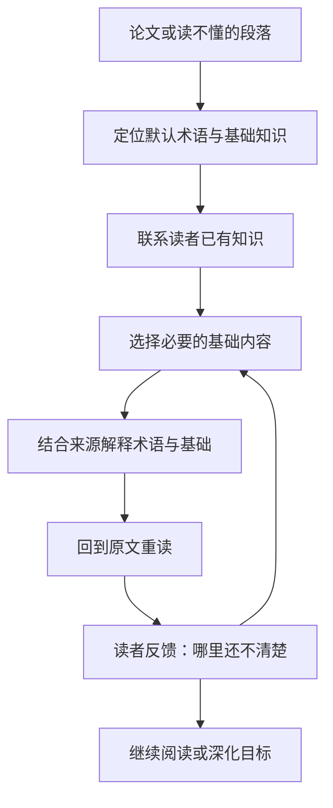

# An Agent on Paper Reading

[English](README.md) | **简体中文**

一个以物理为基础、帮助读者进入陌生研究领域的论文阅读 Agent，通过补充必要的基本术语和基础知识，帮助读者理解原本读不懂的论文。

> **当前状态：设计阶段。** 本仓库目前包含项目介绍和开发路线图，尚未实现 Agent、用户界面或评测流程。

## 为什么做这个项目

刚接触一个领域时，读者往往不了解其中的基本术语、常用概念、符号约定、典型模型和基础假设。研究论文通常默认读者已经具备这些知识，不再逐一解释，因此读者可能连一整段话都无法理解。

此时，读者还可能不知道自己究竟缺少什么，也无法提出准确的问题。查一个术语，又遇到几个新的陌生概念，难以找到合适的学习起点。

这个 Agent 的核心任务是帮助读者跨过这道入门障碍：识别论文默认的必要术语和基础知识，从读者已经理解的内容出发进行解释，再帮助读者回到原文，理解此前读不懂的段落。整个过程根据读者的反馈调整；它是读论文的帮手，不是对读者的测验。

物理提供初始任务和正确性检查。设计面向不同物理子领域，并计划扩展到相邻学科，不以学历、研究经历或专业方向限定使用者。

## 预期阅读流程

1. **从论文或读不懂的段落开始。** 读者可以只说“我刚接触这个领域，这一段看不懂”，无需先提出精确的专业问题。
2. **建立初步认识。** 识别所选材料讨论的研究问题，以及默认读者已了解的基本术语、符号、概念、模型和方法。
3. **了解读者的基础。** 先列出这个领域及其依赖的基础领域。以拓扑量子物态为例，除了领域本身，还包括量子力学、固体物理中的能带理论、对称性、线性代数和拓扑的基本概念。读者大致说明哪些学过、哪些只是听说过、哪些没接触过，也可以只说一句“我是学计算机的”。这不是测验，可以跳过；系统会根据阅读中的反馈逐步补全，并据此区分表达不熟悉与真正缺少基础知识。
4. **补充必要基础。** 追溯到读者能理解的基础概念，只提取与当前句子相关的部分，用简明而严谨的语言搭出概念图景，附可靠来源，必要时再往前展开。术语表只作辅助。
5. **回到原文重读。** 说明这些术语和基础知识如何帮助理解此前卡住的句子、公式、图表及论证。
6. **根据反馈调整。** 读者仍然卡住时，找到卡在哪里，继续展开；这段读通了，就接着往下读。

例如，一段话连续出现三个陌生术语，而这些术语的定义又依赖一个读者从未学过的概念。系统应识别这项共同基础，用读者能够理解的语言讲清，再解释各术语在文中的含义，并引导读者重新理解这一段。

再如，读者读到“这种材料存在受拓扑保护的边缘态”，却不清楚“拓扑”在这里指什么，也不知道它和量子物理有什么关系。系统不会只给一条术语定义，而是回到读者能理解的两个起点，并且只取这句话用到的部分：

- **拓扑**：研究在连续形变下保持不变的性质。咖啡杯可以连续变形成甜甜圈，因为两者都只有一个洞；洞的个数是整数，不会在连续形变中一点点改变。这个类比只用来说明“整数在连续变化中保持不变”，能带的拓扑并不是实物形状上的洞。
- **量子**：按照量子力学，晶体中电子的能量只能落在一段段“能带”里，能带之间可以隔着能隙。绝缘体中较低的能带被电子填满，与上方的空能带隔着能隙，因此不导电。

再把两者合起来：某些绝缘体的能带可以算出一个只能取整数的“拓扑不变量”，而真空的这个数是 0。整数不能连续变化，要改变就必须让能隙闭合，所以在材料和真空的交界处必然存在能隙闭合、可以导电的状态，这就是边缘态。微小的扰动改变不了这个整数，这就是“保护”。讲解到这里为止，不展开专业推导，但保留结论成立的条件：扰动不能大到让能隙闭合，在一些材料中还不能破坏特定的对称性。

这段讲解本身又用到了“能带”“能隙”“对称性”等术语。如果读者表示没学过固体物理，这些词就要先用一两句话讲清，或换成平实的说法；如果读者学过，就可以直接使用。

### 计划提供的核心内容

| 内容 | 作用 |
| --- | --- |
| 领域与基础地图 | 介绍与当前论文有关的研究问题和背景，列出这个领域依赖的基础领域，读者可以在上面标出自己的大致位置。 |
| 基础概念讲解 | 从读者能理解的基础概念讲起，只讲与当前句子相关的部分，用简明而严谨的语言说明这些概念之间的关系，以及它们如何组合成文中的术语。 |
| 上下文术语表 | 作为辅助，解释基本术语、缩写、符号、别名或译名，以及它们在论文中的具体用法。 |
| 原文重读引导 | 将补充的基础知识对应到原文的句子、公式和图表，并提供来源链接。 |

## 设计原则

- **不止于术语表，讲到基础概念。** 对陌生术语，追溯到读者能理解的基础概念，讲清这些概念以及它们如何组合成文中的术语，而不是只给定义。
- **支持尚不能描述知识缺口的读者。** 从论文中提出可能缺少的知识，允许以“这段看不懂”作为起点。
- **只讲这句话用到的部分。** 从每个基础概念中只提取当前句子需要的那一面，组成一个简单的概念图景，不展开成整门课。
- **简单但不失严谨。** 用清楚易懂的语言代替专业推导。简化只做减法：可以略去细节，但不能说错；类比要说明适用范围，并保留结论成立的关键条件。
- **讲解只用读者懂的词。** 解释一个术语时难免用到其他术语。每个用到的术语，要么读者已经了解，要么当场用一两句话讲清，要么换成平实的说法；拿不准时，宁可顺手补一句解释，也不去考读者。
- **控制补学范围并逐步深化。** 围绕所选材料先解决基本读懂的问题，再按需要深入解释、推导或证据审查。
- **区分两种关系结构。** 知识依赖图描述“需要先理解什么”；论文证据与论证图描述“结论由什么支持”。
- **解释可追溯。** 区分论文原述、背景知识和系统生成的推断，保留来源位置及适用条件。
- **帮助而非测验。** 这是读论文的帮手，不考读者。根据读者的反馈（如“还是不懂”“这个我会”）调整，不出题判定掌握；记住已经讲过的内容，避免重复。
- **先实现明确的工作流。** 从一个控制器和模块化工具起步，只有评估显示有必要时才增加代理或学习型规划策略。
- **评价帮助本身的质量。** 看必要基础是否覆盖、解释是否准确可追溯、是否只用读者能懂的词，以及读者多快能读通卡住的段落。

## 拟议架构



| 模块 | 职责 |
| --- | --- |
| 文档处理 | 解析正文、公式、图表和引用，保留文献版本及原文位置。 |
| 领域入门与术语 | 识别默认的基本术语、符号、模型和方法，形成与当前论文相关的术语表和入门背景。 |
| 目标与前置知识建模 | 整理领域依赖的基础领域，将陌生术语关联到基础概念和技能，表示依赖关系，并控制补学范围。 |
| 读者背景 | 记录读者在领域基础地图上的大致位置、已经讲过的内容和读者的反馈，使讲解从合适的起点开始、只用读者能懂的词，并且不重复。 |
| 检索与解释 | 同时检索入门资料与研究证据，用易理解的语言讲解基础，并保留具体主张的来源。 |
| 规划 | 在询问背景、解释、展开更前面的知识、返回原文和停止之间选择下一步。 |
| 重读引导 | 把补充的基础对应回卡住的句子、公式和图表，带读者把这段重新读一遍。 |

这些是计划中的模块边界，并非已经实现的软件组件。初版可采用结构化记录和小型本地数据库，无需一开始部署专用图数据库。

## 落地形式

核心逻辑放在一个 Python 包里，包括文档处理、术语与基础抽取、领域基础地图、讲解生成和用词检查。各种使用形式只是外层；模型调用通过统一接口接入，可以使用 Claude、GPT 等模型。计划分两步落地：

| 步骤 | 形式 | 用途 |
| --- | --- | --- |
| 第一步（P0–P1） | Agent Skill（`SKILL.md` 工作流）加 Python 核心库，可在 Claude Code 和 Codex 中使用；读者背景和讲解记录保存在本地 JSON 文件中。 | 用 P0 样例快速迭代讲解质量：从哪个基础概念讲起、只取相关部分、简单而严谨、只用读者懂的词。 |
| 第二步（P2–P3） | 基于 arXiv HTML 的本地网页阅读界面：左侧原文，右侧讲解，顶部显示领域基础地图，并提供“还是不懂”“卡在这个词”“这个我会”等反馈按钮。 | 支持选中一句话求助、把讲解对应到原文的句子和公式，以及在基础地图上标出自己的位置。 |

选择 arXiv HTML，是因为物理论文大多发布在 arXiv 上，其 HTML 版由 LaTeX 源码转换而来，段落和公式带有固定编号（如 `S2.p3`、`S2.E1`），讲解可以准确挂到原文位置上，无需解析 PDF。论文没有 HTML 版时，退回 LaTeX 源码或 PDF 解析。网页界面稳定后，可再包装成在 arxiv.org 页面上直接使用的浏览器扩展；MCP server、Zotero 插件等形式以后按需增加。

## 开发路线

| 阶段 | 交付内容 | 完成标准 |
| --- | --- | --- |
| P0 — 入门障碍样例 | 从两个物理子领域选择段落，为每个子领域整理基础领域地图，并标注陌生基本术语、默认基础和入门来源。 | 明确新读者需要补充哪些基础，以及可靠的入门来源。 |
| P1 — 术语与基础补全助手 | 以 Agent Skill 和 Python 核心库提供：文档导入、来源导航、基础概念讲解、上下文术语表和原文重读引导。 | 审核者可追溯讲解来源，并检查必要基础概念是否覆盖。 |
| P2 — 个性化缺口诊断 | 领域基础地图、前置关系、读者自述的背景和讲解记录；搭建基于 arXiv HTML 的阅读界面初版。 | 能帮助尚不能说清缺口的读者，同时避免重复讲解已掌握的基础。 |
| P3 — 按反馈展开的阅读闭环 | 在阅读界面中根据读者反馈逐步规划，按需展开前置知识。 | 流程遵守预算、能够终止，始终围绕原文段落，不把读者带离太远。 |
| P4 — 跨子领域评测 | 与静态术语表、普通 RAG 和固定专家阅读指南比较。 | 在可比条件下比较基础覆盖、解释准确性，以及读通卡住段落所需的时间。 |
| P5 — 相邻学科扩展 | 可替换的领域资源、术语、证据标准和评价规则。 | 在新领域留出的任务上重新验证适配后的流程。 |

**初始 MVP 范围：** 基于 P0 的人工样例，实现 P1–P3。所有实现和评测阶段目前均待完成。

## 评测计划

评测的对象是帮助本身，不是读者。首先验证：对刚进入某个领域的读者，这套流程能否帮助他们读通此前因术语陌生和基础缺失而卡住的段落。对照包括静态术语表或入门阅读指南、普通检索增强问答，以及固定的专家阅读指南；在适用时使用相同模型、资料库和文档解析结果。

重点测量：

- 是否覆盖 P0 标注的必要基础，以及额外补充的负担。
- 术语在当前论文中的含义是否解释准确，包括公式和图表。
- 解释是否用到了读者不了解、又没有加以说明的术语。
- 引用支持度、来源可追溯性，以及遗漏的假设。
- 从卡住到继续往下读所用的时间，包括等待时间。
- 读者自己判断能否继续读下去，以及仍然卡在哪里。

读者反馈用于改进 Agent，而不是给读者打分。大部分讲解质量指标可以通过自动检查和专家审核来评估；帮助在实际阅读中是否有用，需要小规模读者试用来确认。目前尚未取得这类结果。

## 参考项目与论文

以下是设计参考，不代表已经集成的依赖，也不代表与相关项目存在合作关系。

- [Docling](https://github.com/docling-project/docling)：结构化文档解析。
- [PaperQA](https://github.com/Future-House/paper-qa)：科学文献检索、证据提取与带引用的回答。
- [RPKT](https://arxiv.org/html/2508.11892v2)：递归发现前置知识。
- [GenMentor](https://github.com/GeminiLight/gen-mentor)：目标导向的学习者建模与学习路径组织。
- [Qlarify](https://doi.org/10.1145/3654777.3676397)：可递归展开并关联原文段落的解释。
- [ScholarPhi](https://doi.org/10.1145/3411764.3445648)：在阅读位置即时显示术语和符号的定义，定义取自同一篇论文的其他位置；本项目关注的则是论文默认读者已知、未加定义的基础知识。
- [Paper Plain](https://doi.org/10.1145/3589955)：为非专业读者提供医学论文的术语释义和分节通俗摘要。
- [Pxplore](https://arxiv.org/html/2510.13215v2)：目标驱动的学习者状态建模与路径规划。

复用这些思路本身不构成新的研究贡献。采用具体组件前，需要分别核对代码、模型和数据的许可。

## 仓库内容

```text
an-agent-on-paper-reading/
├── README.md          # 英文项目介绍与路线图
├── README.zh-CN.md    # 中文项目介绍与路线图
└── .gitignore         # 本地产物、凭据和私有数据的排除规则
```

目前没有安装或运行命令。下一步是收集新读者看不懂的段落，标注其中的必要术语与基础知识依赖，确定来源定位格式和讲解质量的评价标准，再开始实现。

## 许可证

项目许可证尚未确定。
